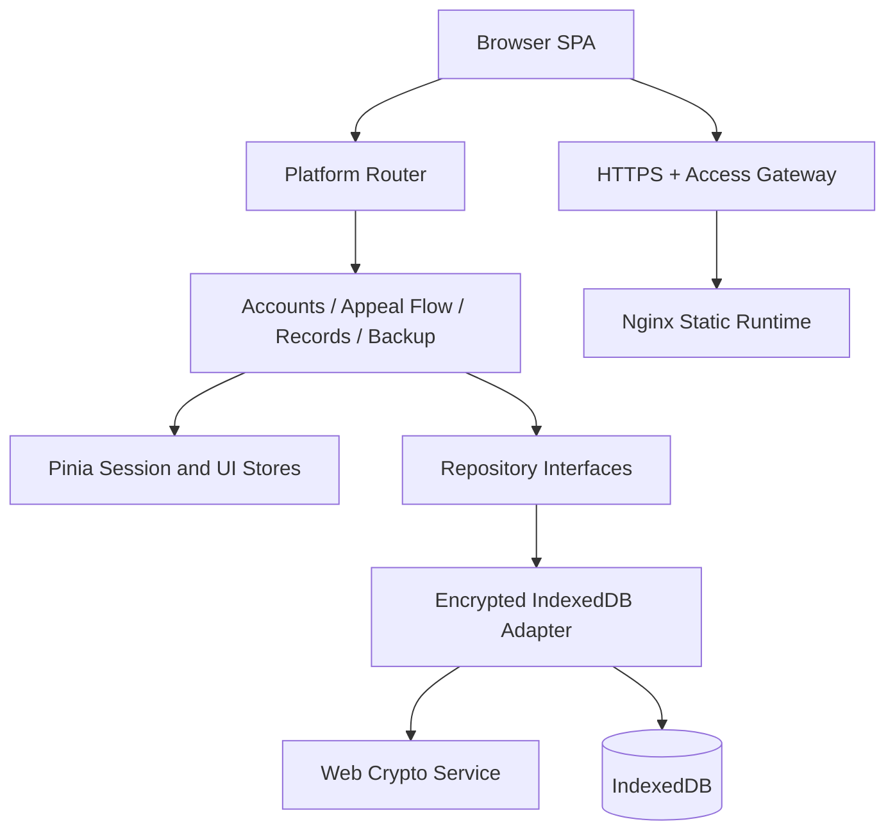
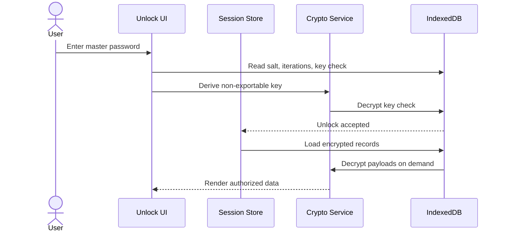
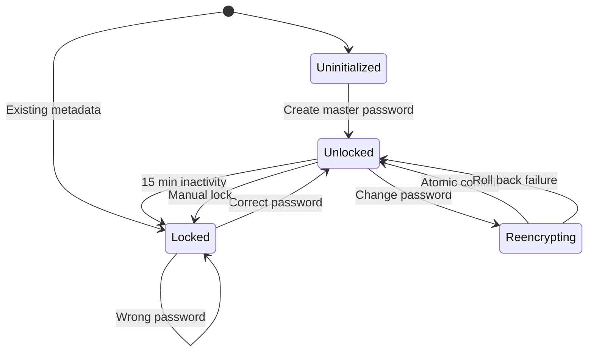
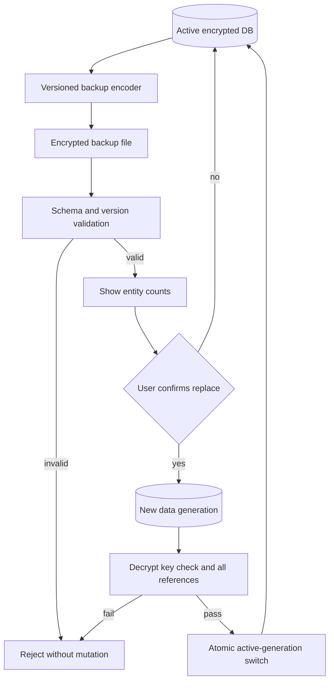

# Multi-Platform Appeal Manager - Plan

## Goal Capsule

- **Objective:** 提供一个可在公网部署、主要供单人使用的前端管理工具，安全管理 INS、Google、TikTok、Ping0 的账号资料、申诉流程和申诉记录。
- **Means:** 使用 Vue 单页应用、浏览器本地加密数据库、加密备份文件，以及带访问保护的静态部署方案实现目标（KTD1-KTD9）。
- **Authority:** Product Contract 的 R-ID 定义产品行为；Planning Contract 的 KTD-ID 定义实现机制；Implementation Units 不得改变两者。
- **Execution profile:** 绿地项目、代码交付、安全敏感、持久化数据、深度计划。
- **Stop conditions:** 如果实现需要多人共享、云端同步、服务端账号系统或自动调用第三方平台，应停止并返回产品范围确认。
- **Tail ownership:** 完成代码、自动化测试、生产构建、容器运行验证、Git 安全检查和部署文档后才可交付。

---

## Product Contract

### Summary

构建一个四平台共用的中文管理后台。应用在浏览器本地保存加密数据，支持完整备份恢复，并可以通过 HTTPS、入口认证和应用主密码安全部署到公网。

### Problem Frame

账号、邮箱密码、2FA、申诉模板和申诉过程目前缺少统一管理入口。四个平台拥有相同的管理需求，但每个平台的数据必须清晰隔离。

第一版不使用业务后端，因此部署成功不等于数据同步。应用必须明确采用“固定域名下的单浏览器数据 + 加密文件迁移”的运行模型，同时避免任何真实密钥或私密数据进入 Git 仓库和前端构建产物。

### Key Decisions

- KD1. **公网部署、个人使用、浏览器数据隔离。** (session-settled: user-directed — chosen over multi-user shared data: the user selected a public deployment intended mainly for personal use.) Governs R1, R15, R20, R22.
- KD2. **四个平台共用一套能力模型。** 页面、表单和数据访问逻辑按平台参数化，不复制四套实现。Governs R1-R3, R5, R7, R11.
- KD3. **私密运行数据不进入 Git。** 业务数据存储在浏览器数据库；部署凭据使用托管平台或 CI Secret；仓库只包含示例配置。Governs R18, R23-R25.

### Requirements

#### Platform and Navigation

- R1. 应用必须支持 INS、Google、TikTok、Ping0 四个固定平台，并将每条业务数据归属到一个平台。
- R2. 用户必须能够在平台之间切换，并在当前平台下访问账号管理、申诉模块、申诉步骤和申诉记录。
- R3. 平台切换必须保留统一的页面和交互结构，同时只展示当前平台的数据。

#### Account Management

- R4. 账号记录必须包含国家、账号、密码、邮箱账号、邮箱密码和 2FA。
- R5. 用户必须能够新增、编辑、搜索、筛选、复制和删除或归档账号记录。
- R6. 密码、邮箱密码和 2FA 必须默认隐藏，只能在应用已解锁时查看或复制。

#### Appeal Modules and Steps

- R7. 用户必须能够为当前平台新增、编辑、排序、启用、归档和删除未被引用的申诉模块。
- R8. 申诉模块必须至少包含名称、说明、启用状态、排序和备注。
- R9. 用户必须能够在申诉模块下新增、编辑、排序和归档申诉步骤。
- R10. 申诉步骤必须至少包含所属模块、步骤名称、操作说明、排序和备注。

#### Appeal Records

- R11. 申诉记录必须包含状态、国家、IP、申诉时间、申诉平台、备注、模板 1 和模板 2。
- R12. 申诉记录必须能够选择性关联账号、申诉模块和当前步骤。
- R13. 状态必须从准备中、已提交、审核中、申诉成功、申诉失败、需要补充和已关闭中选择。
- R14. 用户必须能够新增、编辑、搜索、筛选、复制模板内容和删除申诉记录。

#### Security and Local Persistence

- R15. 所有业务数据必须在刷新和浏览器重启后继续存在，并保持在当前浏览器和当前站点来源内。
- R16. 账号、密码、邮箱资料、2FA、模板和备注等业务载荷必须加密后才能写入持久化存储。
- R17. 主密码不得持久化；解密密钥只能在解锁会话的内存中存在。
- R18. 应用必须在首次使用时建立至少 12 个字符并二次确认的主密码，在后续访问时要求解锁，并在连续无操作 15 分钟后自动锁定；不采用强制大小写、数字或符号组合规则。
- R19. 错误主密码、损坏密文和不支持的数据版本不得暴露部分明文或破坏现有数据。
- R20. 应用必须支持导出完整加密备份；导入时必须先验证备份主密码，再预览内容计数并通过原子替换恢复数据，且不得在验证前泄露业务计数或明文。
- R21. 用户更改主密码时，应用必须在一个可回滚流程中重新加密全部业务数据。

#### Deployment and Repository Safety

- R22. 应用必须生成可由 Nginx、Docker 或兼容静态托管平台提供的生产构建产物。
- R23. 生产部署必须使用 HTTPS，并在应用外部提供入口认证；应用内部继续使用主密码保护本地数据。
- R24. Git 仓库必须忽略真实环境文件、备份文件、本地数据、日志、依赖目录和构建产物，同时提交无敏感值的示例配置。
- R25. 前端源码、客户端环境变量和构建产物不得包含部署密码、第三方密钥或真实账号数据。
- R26. 持续集成必须验证依赖安装、格式与静态检查、类型检查、单元测试、端到端测试、生产构建、容器烟雾测试、生产依赖审计和敏感文件扫描。

#### Usability and Accessibility

- R27. 所有管理页面必须提供可区分的加载、空数据、错误和成功反馈；核心导航、表单、表格操作和弹窗必须可通过键盘完成，具有可见焦点与可访问名称，并在桌面和窄屏下保持可操作。

### Key Flows

- F1. First-time setup and unlock
  - **Trigger:** 用户首次打开部署后的应用。
  - **Steps:** 设置并确认至少 12 个字符的主密码；生成加密元数据；进入已解锁状态；开始管理数据。
  - **Outcome:** 本地数据库已初始化，主密码本身未被保存。
  - **Covered by:** R15-R19.
- F2. Platform data management
  - **Trigger:** 用户选择一个平台和一个管理页面。
  - **Steps:** 查看当前平台数据；新增或编辑记录；验证输入；加密并保存；刷新列表。
  - **Outcome:** 数据仅出现在所属平台，并在刷新后保留。
  - **Covered by:** R1-R14, R16, R27.
- F3. Appeal tracking
  - **Trigger:** 用户为一个账号建立申诉记录。
  - **Steps:** 选择账号和申诉模块；填写状态、IP、时间和模板；选择当前步骤；后续更新状态。
  - **Outcome:** 申诉过程可以从账号追踪到模块、步骤和最终状态。
  - **Covered by:** R7-R14.
- F4. Backup and restore
  - **Trigger:** 用户导出备份或在同域名的新浏览器中恢复数据。
  - **Steps:** 导出加密文件；选择备份；验证格式和参数边界；输入备份主密码；解密验证完整性；预览计数；确认替换；原子恢复。
  - **Outcome:** 有效备份完整恢复；空数据库采用备份主密码，已有数据库保留当前主密码；无效备份不改变现有数据库。
  - **Covered by:** R19-R21.

### Acceptance Examples

- AE1. **Covers R1-R6:** Given 当前平台为 TikTok, when 用户新增一个账号并刷新页面, then 该账号仍在 TikTok 中可见，切换到 Google 时不可见。
- AE2. **Covers R6, R17-R18:** Given 应用处于锁定状态, when 用户直接进入账号页面, then 密码字段不可访问并被重定向到解锁页面。
- AE3. **Covers R7-R10:** Given 一个模块已有被申诉记录引用的步骤, when 用户尝试删除该步骤, then 系统阻止永久删除并允许归档。
- AE4. **Covers R11-R14:** Given 用户建立一条申诉记录, when 选择关联账号、模块和当前步骤, then 表格能够展示关联摘要并允许更新状态。
- AE5. **Covers R18-R19:** Given 用户输入错误主密码, when 解锁失败, then 应用保持锁定且不返回任何业务明文。
- AE6. **Covers R20:** Given 当前数据库已有数据, when 用户导入格式损坏或版本不支持的文件, then 导入失败且原数据保持不变。
- AE7. **Covers R21:** Given 用户更改主密码, when 中途重新加密失败, then 应用继续使用旧主密码和旧数据集工作。
- AE8. **Covers R22-R26:** Given 一个全新环境和仓库内容, when CI 执行完整质量门禁并构建容器, then 静态应用可通过 SPA 路由刷新并且仓库中没有真实 Secret。
- AE9. **Covers R27:** Given 一个管理页面正在加载、没有数据或保存失败, when 用户通过键盘进入并操作页面, then 页面展示对应状态、焦点顺序可预测且核心操作不依赖鼠标。

### Success Criteria

- 四个平台的四类数据均能完成新增、编辑、查看、筛选和删除或归档流程。
- 关闭并重新打开浏览器后，正确主密码可以恢复全部数据，错误主密码不能恢复任何业务明文。
- 加密备份能够在空数据库中完整恢复，损坏备份不会改变现有数据。
- 项目能够通过 CI 质量门禁，并能由生产 Nginx 容器在 HTTPS 反向代理后运行。
- Git 历史和构建产物不包含业务数据、主密码或部署凭据。
- 加载、空数据、错误和成功状态清晰可见，核心流程可以仅使用键盘完成。

### Scope Boundaries

#### Deferred to Follow-Up Work

- 服务端用户登录、云端数据库、多设备自动同步和多人共享。
- PWA 安装、离线更新策略和推送通知。
- CSV 批量导入、附件上传、数据统计和仪表盘。
- 可配置平台列表和自定义字段设计器。

#### Outside This Product

- 自动登录第三方平台、自动提交申诉或调用平台 API。
- 自动收取邮箱验证码、生成 2FA 动态码或验证账号凭据有效性。
- 绕过第三方平台的安全、风控或访问限制。

---

## Planning Contract

### Assumptions

- 第一版界面使用中文，并以桌面端最新稳定版 Chrome、Edge 和 Firefox 为主要目标。
- 公网入口认证由 Nginx Basic Auth、Cloudflare Access 或同等部署层能力提供；凭据不由前端应用管理。
- 默认无操作锁定时间为 15 分钟，第一版不提供关闭自动锁定的选项。
- 被账号或申诉记录引用的账号、模块和步骤只能归档，未引用的数据才允许永久删除。
- 导入采用全量替换而非按记录合并；多设备合并属于后续同步能力。
- 固定生产域名是数据可达性的运营前提；更换域名通过导出和导入迁移。
- 个人数据规模预计低于 10,000 条业务记录；搜索和筛选可以在解锁后对内存中的解密视图执行。

### Key Technical Decisions

- KTD1. **Use the current stable Vue toolchain.** 基线固定为 Node 24 LTS、Vue 3.5、Vite 8、TypeScript 6.0.3、Vue Router 5、Pinia 4 和 Element Plus 2；`package-lock.json` 固定精确解析结果。TypeScript 版本保持在 `typescript-eslint` 8.67.0 支持的 `<6.1.0` 范围内。
- KTD2. **Use one parameterized platform domain.** 平台使用固定 ID，路由、查询和功能组件接收平台上下文，不创建四套页面或存储表。
- KTD3. **Separate domain repositories from storage.** 页面和 Pinia store 依赖仓储接口；第一版提供 Dexie/IndexedDB 适配器，未来 HTTP API 适配器可以替换它而不改变功能页面。
- KTD4. **Encrypt complete business payloads.** 每条记录只保留 UUID、实体类型、平台 ID、数据版本、generation ID 和时间戳等必要索引元数据为明文；其余载荷使用 AES-256-GCM、每次加密唯一随机 96-bit IV。全部明文索引元数据按稳定序列化规则作为 AES-GCM authenticated additional data 参与认证，防止密文被替换到另一实体、平台或 generation。备份另含一个加密 manifest，用于认证格式版本、数据库版本和实体计数。这接受少量记录数量和平台类型泄露，以换取不持久化账号、国家、模板或备注明文。
- KTD5. **Derive the encryption key from the master password.** 主密码至少 12 个字符，只要求二次确认而不强制字符类别；使用 PBKDF2-HMAC-SHA-256、随机 salt 和不少于 600,000 次迭代。迭代次数存入加密元数据以支持未来升级，派生密钥不可导出且只存在内存。导入数据必须限制文件大小、salt、IV、密文长度和 KDF 迭代范围，防止恶意备份触发资源耗尽。
- KTD6. **Use a locked-session state machine.** 启动时只加载加密元数据；解锁成功后加载和解密业务数据；锁定时清除内存密钥、解密缓存和敏感 store 状态。
- KTD7. **Make restore and re-encryption generation-based.** 备份包含格式版本、数据库版本、加密元数据、加密 manifest 和密文记录。导入必须用备份主密码解密并验证全部记录；空数据库直接采用备份加密元数据，已有数据库则使用当前内存密钥把导入数据重新加密到新的 generation，从而保留当前主密码。恢复或改密先在事务外完成解密、加密与全量验证，再写入 staging generation，最后在同一个短事务中切换 active generation 指针并删除所有旧 generation。任一步骤失败时事务回滚且旧 generation 保持活动；成功后不得残留可由旧主密码解密的业务 generation。
- KTD8. **Treat deployment security as two layers.** Nginx/Docker 提供 SPA 回退、缓存策略和安全响应头；外部入口认证阻止匿名访问；应用主密码保护浏览器静态数据。
- KTD9. **Keep Git and CI secret-free.** `.gitignore` 排除私密输出，`.env.example` 只含占位符，CI/部署凭据只从 Secret 注入；构建和测试不得依赖开发者本机私密文件。仓库脚本检查被跟踪文件和 Docker 构建上下文中的禁止路径，CI 另运行 Gitleaks 扫描提交内容。

### High-Level Technical Design

#### Component topology



#### Unlock and persistence sequence



#### Session lifecycle



#### Backup and restore data flow



### Sequencing

先建立质量门禁和领域契约，再实现加密持久化。功能页面只能在仓储和会话安全边界稳定后接入。备份恢复建立在最终数据格式之上，生产部署最后验证完整构建和运行路径。

### System-Wide Impact

- **User data lifecycle:** 数据生命周期完全由浏览器来源、主密码、备份文件和用户清理行为决定。
- **Security boundary:** 应用解锁后，XSS 可以读取内存明文，因此 CSP、依赖控制和禁止远程脚本与加密算法同等重要。
- **Operations:** 更换生产域名或清理站点数据前必须先导出备份。
- **Future backend:** 仓储接口和稳定 UUID 为未来迁移提供边界，但第一版不实现同步协议或冲突解决。

### Risks and Mitigations

| Risk | Impact | Mitigation |
|---|---|---|
| XSS 或恶意依赖在解锁后读取数据 | 高 | 严格 CSP；不使用远程脚本；锁定依赖；编码模板仅按纯文本展示；安全审查依赖更新 |
| 用户忘记主密码 | 高 | 首次设置和修改时明确不可恢复；要求确认；提供备份提示；不实现后门或恢复密钥 |
| 浏览器清理、隐私模式或域名变化导致数据不可达 | 高 | 固定生产域名；显示持久化说明；提供加密导出；恢复前预览与验证 |
| PBKDF2 在低性能设备上解锁过慢 | 中 | 以 600,000 次为安全下限进行目标浏览器基准；记录迭代参数以允许未来调优和升级 |
| 导入或改密过程中断造成损坏 | 高 | 使用 staging/事务和旧数据保留；只有验证完成后才替换活动数据 |
| 恶意备份声明极端 KDF 参数或巨大密文 | 高 | 解析前限制文件大小；验证 salt、IV、密文和迭代范围；超过限制时不执行派生或写入 |
| 入口认证配置错误导致页面公开 | 高 | 提供可验证的 Nginx 示例、部署检查清单和匿名访问拒绝的容器烟雾测试 |
| Git 误提交备份或凭据 | 高 | 广泛 `.gitignore`、示例配置、CI Secret、提交前与 CI 的敏感文件路径检查 |

### Alternative Approaches Considered

- **Four separate platform applications:** 拒绝。重复页面、验证和迁移逻辑会放大维护成本。
- **Plain localStorage:** 拒绝。容量、结构化查询和敏感数据风险不符合要求。
- **Backend-first shared database:** 延后。它解决多设备同步，但超出个人使用和无业务后端的第一版范围。
- **Argon2id through WebAssembly:** 延后。它提供更强的内存成本，但增加供应链、加载和兼容复杂度；第一版采用浏览器原生 PBKDF2，并保留可升级的 KDF 元数据。
- **PWA in the first release:** 延后。Service Worker 缓存会增加更新和敏感应用运维复杂度，静态部署本身已满足当前目标。

### Documentation and Operational Notes

- 部署前必须确认生产域名、HTTPS 终止位置、入口认证方式、Secret 注入方式和备份下载路径。
- Go 条件为 CI 全绿、容器烟雾测试通过、匿名访问被拒绝、深层路由可刷新、安全响应头存在且构建产物不含私密文件。
- No-Go 条件为入口认证不可验证、CSP 需要开放 `unsafe-eval`、生产依赖存在未豁免的高危漏洞、备份恢复失败或浏览器无法持久化 IndexedDB。
- 部署回滚通过恢复上一版本静态镜像完成；如果未来版本包含数据格式迁移，发布前必须先证明上一版本仍可读取活动 generation 或提供经过验证的备份恢复路径。
- 上线后人工验证首次解锁、自动锁定、一个平台的完整 CRUD、备份下载和深层路由刷新；数据只在浏览器中，不建立服务端业务日志或监控明文。

---

## Output Structure

```text
.
|-- .github/
|   |-- dependabot.yml
|   `-- workflows/ci.yml
|-- deploy/
|   |-- nginx.conf
|   `-- docker-compose.example.yml
|-- docs/
|   |-- DEPLOYMENT.md
|   |-- SECURITY.md
|   `-- plans/
|-- public/
|-- scripts/
|   `-- check-sensitive-files.mjs
|-- src/
|   |-- App.vue
|   |-- main.ts
|   |-- components/
|   |-- data/
|   |   |-- indexeddb/
|   |   `-- repositories/
|   |-- domain/
|   |-- features/
|   |   |-- accounts/
|   |   |-- appeal-flow/
|   |   |-- appeal-records/
|   |   |-- backup/
|   |   `-- unlock/
|   |-- layouts/
|   |-- router/
|   |-- security/
|   |-- stores/
|   `-- styles/
|-- tests/
|   |-- e2e/
|   `-- smoke/
|-- .dockerignore
|-- .env.example
|-- .gitleaks.toml
|-- .gitignore
|-- .nvmrc
|-- .prettierrc.json
|-- Dockerfile
|-- eslint.config.js
|-- package.json
|-- package-lock.json
|-- tsconfig.json
`-- vite.config.ts
```

---

## Implementation Units

### U1. Repository and quality foundation

- **Goal:** 创建可重复安装、构建和验证的 Vue 项目基础。
- **Requirements:** R22-R27.
- **Dependencies:** None.
- **Files:** `package.json`, `package-lock.json`, `.nvmrc`, `vite.config.ts`, `tsconfig.json`, `eslint.config.js`, `.prettierrc.json`, `.gitignore`, `.env.example`, `.gitleaks.toml`, `scripts/check-sensitive-files.mjs`, `src/main.ts`, `src/App.vue`, `.github/workflows/ci.yml`, `.github/dependabot.yml`.
- **Approach:** 使用 Node 24 LTS 和 npm；配置 Vue、TypeScript、Element Plus、Pinia、Vue Router、Vitest、Vue Test Utils 和 Playwright；脚本统一提供 lint、format check、typecheck、unit、e2e 和 build。
- **Execution note:** 这是脚手架和质量门禁工作，优先用安装、构建和最小浏览器烟雾验证证明基础可用。
- **Patterns to follow:** Vite 官方 Vue TypeScript 模板；仓库中不读取未提交的本地 Secret。
- **Test scenarios:** Test expectation: none -- 此单元只建立脚手架和质量门禁；运行结果由 Verification Contract 验证。
- **Verification:** 全新检出能够通过锁文件安装依赖，启动开发服务器并生成生产构建。

### U2. Domain model and repository contracts

- **Goal:** 定义平台、实体关系、状态、验证规则和可替换的数据访问边界。
- **Requirements:** R1-R5, R7-R14.
- **Dependencies:** U1.
- **Files:** `src/domain/platform.ts`, `src/domain/account.ts`, `src/domain/appeal-module.ts`, `src/domain/appeal-step.ts`, `src/domain/appeal-record.ts`, `src/domain/backup.ts`, `src/domain/validation.ts`, `src/data/repositories/account-repository.ts`, `src/data/repositories/appeal-repository.ts`, `src/data/repositories/settings-repository.ts`, `src/domain/__tests__/validation.spec.ts`, `src/data/repositories/__tests__/repository-contract.spec.ts`.
- **Approach:** 使用稳定 UUID、ISO 时间和连续数据版本；平台采用固定 ID；申诉记录通过可选外键关联账号、模块和步骤；验证层拒绝空必填字段、非法 IP、无效状态和跨平台关联。
- **Patterns to follow:** KTD2、KTD3；Zod schema 作为表单、导入和仓储边界的共同验证来源。
- **Test scenarios:**
  - 创建六个必填账号字段均有效的记录时通过验证并保留平台 ID。
  - 空账号、无效 IP、无效状态和不存在的平台 ID 被拒绝，并返回字段级错误。
  - 申诉记录引用不同平台的账号、模块或步骤时被拒绝。
  - 已归档实体仍可被历史记录读取，但不能被新记录默认选择。
- **Verification:** 每个实体拥有稳定类型、运行时验证和仓储契约，功能层无需了解 IndexedDB。

### U3. Encryption, IndexedDB, and session lock

- **Goal:** 建立主密码、加密持久化、锁定会话和安全改密能力。
- **Requirements:** R6, R15-R19, R21.
- **Dependencies:** U2.
- **Files:** `src/security/crypto-service.ts`, `src/security/key-derivation.ts`, `src/security/session-lock.ts`, `src/data/indexeddb/database.ts`, `src/data/indexeddb/encrypted-repositories.ts`, `src/stores/session.ts`, `src/features/unlock/UnlockView.vue`, `src/security/__tests__/crypto-service.spec.ts`, `src/data/indexeddb/__tests__/database.spec.ts`, `src/stores/__tests__/session.spec.ts`, `tests/e2e/unlock.spec.ts`.
- **Approach:** 按 KTD4-KTD7 实现非导出密钥、唯一 IV、authenticated additional data、key check、按需解密和自动锁定；改密在新 generation 中写入重新加密的数据，完成全量验证后在同一事务中切换 active generation 并删除旧 generation。
- **Execution note:** 加密与回滚路径采用测试优先；在连接功能页面前先证明错误密码、损坏密文和自动锁定行为。
- **Patterns to follow:** Web Crypto secure-context API；Dexie 版本迁移；敏感数据不进入 localStorage、URL、日志或错误信息。
- **Test scenarios:**
  - 相同明文连续加密两次产生不同 IV 和密文，均可由正确密钥还原。
  - 错误主密码无法通过 key check，仓储不会返回任何已解密实体。
  - 修改一个密文字节会导致 AES-GCM 认证失败且原记录保持不变。
  - 修改记录 ID、平台、实体类型、版本或 generation 等外层元数据会导致 AES-GCM 认证失败。
  - 15 分钟无操作后密钥和解密 store 被清除，受保护路由返回解锁页。
  - 改密成功后旧密码失效、新密码可解密全部数据。
  - 改密成功事务中不保留任何旧 generation；事务失败时活动指针和旧 generation 一并回滚。
  - 改密中途失败时旧密码和旧数据仍然可用。
- **Verification:** 正确密码是访问业务数据的唯一应用内路径；锁定会话不保留可复用明文或密钥引用。

### U4. Application shell and platform navigation

- **Goal:** 创建统一的平台侧边栏、功能导航、锁定路由和响应式管理布局。
- **Requirements:** R1-R3, R6, R18, R27.
- **Dependencies:** U1, U3.
- **Files:** `src/router/index.ts`, `src/layouts/AppShell.vue`, `src/components/PlatformSwitcher.vue`, `src/components/SecretField.vue`, `src/stores/platform.ts`, `src/styles/index.css`, `src/layouts/__tests__/AppShell.spec.ts`, `tests/e2e/navigation.spec.ts`.
- **Approach:** 使用带平台参数的嵌套路由；路由守卫检查解锁状态和合法平台；SecretField 统一处理隐藏、短时显示和复制；共享状态组件统一呈现加载、空数据、错误和成功反馈，并建立键盘导航、焦点恢复和可访问名称约定。
- **Patterns to follow:** KTD2、KTD6；Element Plus 中文 locale；桌面优先并保证窄屏可操作。
- **Test scenarios:**
  - 从 INS 切换到 Google 时 URL 和平台上下文同步，页面只请求 Google 数据。
  - 非法平台 URL 进入安全的默认平台或 404 状态，不读取数据。
  - 锁定状态访问任一功能路由时跳转到解锁页，解锁后返回原目标。
  - SecretField 默认遮蔽内容，只有已解锁会话才能显示或复制。
  - 侧边栏、平台切换、弹窗和表单可仅用键盘操作；弹窗关闭后焦点返回触发控件，窄屏下核心操作仍可见。
- **Verification:** 四个平台共享同一布局和路由结构，任何受保护页面都不能绕过会话锁。

### U5. Account management

- **Goal:** 完成账号记录的表格、表单、筛选、敏感字段和引用安全行为。
- **Requirements:** R4-R6, R15-R19, R27.
- **Dependencies:** U2-U4.
- **Files:** `src/features/accounts/AccountsView.vue`, `src/features/accounts/AccountFormDrawer.vue`, `src/features/accounts/account-store.ts`, `src/features/accounts/__tests__/AccountsView.spec.ts`, `tests/e2e/accounts.spec.ts`.
- **Approach:** 表格展示非敏感摘要；抽屉表单新增和编辑完整记录；国家和账号支持搜索；永久删除前查询引用，已引用账号改为归档。
- **Patterns to follow:** 通用 SecretField、领域验证、仓储接口和当前平台上下文。
- **Test scenarios:**
  - Covers AE1. 在 TikTok 新增账号后刷新仍存在，Google 列表不出现该记录。
  - 缺少账号或邮箱密码时表单显示对应验证错误且不写入数据库。
  - 编辑账号后列表更新时间变化，其他敏感字段不被意外清空。
  - 未引用账号可确认后永久删除；被申诉记录引用的账号只能归档。
  - Covers AE2. 自动锁定后，已打开的账号详情立即停止展示敏感值。
- **Verification:** 账号管理覆盖完整 CRUD、平台隔离、敏感显示控制和引用安全删除。

### U6. Appeal module and step management

- **Goal:** 完成可复用申诉模块及其有序步骤的管理界面。
- **Requirements:** R7-R10, R12, R27.
- **Dependencies:** U2-U4.
- **Files:** `src/features/appeal-flow/AppealFlowView.vue`, `src/features/appeal-flow/ModuleEditor.vue`, `src/features/appeal-flow/StepEditor.vue`, `src/features/appeal-flow/appeal-flow-store.ts`, `src/features/appeal-flow/__tests__/AppealFlowView.spec.ts`, `tests/e2e/appeal-flow.spec.ts`.
- **Approach:** 模块使用可排序列表；选中模块后管理步骤；排序写入稳定序号；跨平台移动不允许；引用中的模块和步骤执行归档而非永久删除。
- **Patterns to follow:** R7-R10 的字段所有权；仓储事务保证一次排序更新不会产生重复序号。
- **Test scenarios:**
  - 新增模块和三个步骤后，刷新保持顺序和所属关系。
  - 调整步骤顺序时所有相关序号在一个事务中更新。
  - 禁用模块后历史记录仍可展示，但新申诉记录不默认提供该模块。
  - Covers AE3. 被申诉记录引用的步骤不能永久删除，只能归档。
  - 不同平台的模块和步骤不能互相引用或排序。
- **Verification:** 每个平台可以建立独立、可排序、可归档的申诉流程模板。

### U7. Appeal record management

- **Goal:** 完成申诉记录、关联选择、状态追踪和模板复制流程。
- **Requirements:** R11-R14, R16, R27.
- **Dependencies:** U2-U6.
- **Files:** `src/features/appeal-records/AppealRecordsView.vue`, `src/features/appeal-records/AppealRecordFormDrawer.vue`, `src/features/appeal-records/appeal-record-store.ts`, `src/features/appeal-records/__tests__/AppealRecordsView.spec.ts`, `tests/e2e/appeal-records.spec.ts`.
- **Approach:** 表格显示状态、国家、IP、时间和关联摘要；抽屉编辑完整记录；模板始终按纯文本处理；关联选择只提供当前平台未归档实体。
- **Patterns to follow:** 固定状态集合、领域跨平台验证、SecretField 或专用复制控件。
- **Test scenarios:**
  - Covers AE4. 创建关联账号、模块和当前步骤的记录后，表格显示正确摘要并可更新状态。
  - 无效 IPv4/IPv6、未来格式不合法的时间或未知状态阻止保存。
  - 模板中的 HTML 或脚本字符串按纯文本显示和复制，不执行内容。
  - 归档关联实体后历史记录仍能通过保留的关联读取其标签，但新记录不再提供该实体。
  - 按状态、国家、账号和时间范围筛选只返回当前平台记录。
- **Verification:** 申诉记录能够从创建到关闭持续更新，并保持平台和关联完整性。

### U8. Encrypted backup and restore

- **Goal:** 提供可迁移、可验证、失败不损坏数据的完整备份恢复能力。
- **Requirements:** R19-R21, R27.
- **Dependencies:** U3, U5-U7.
- **Files:** `src/features/backup/BackupView.vue`, `src/features/backup/backup-service.ts`, `src/features/backup/backup-schema.ts`, `src/features/backup/__tests__/backup-service.spec.ts`, `tests/e2e/backup-restore.spec.ts`.
- **Approach:** 导出版本化加密包；导入先验证文件大小、JSON shape、版本和参数边界，再要求备份主密码并解密认证 manifest、key check 和全部记录，验证完成后才展示实体计数。确认恢复后，空数据库采用备份加密元数据；已有数据库使用当前会话密钥重新加密到新 generation；最后在一个事务中切换活动指针并删除旧 generation。
- **Execution note:** 先写破损文件、错误密码、旧版本和中断恢复的失败测试，再实现成功路径。
- **Patterns to follow:** KTD7；文件输入不信任；任何失败发生时活动数据库保持原样。
- **Test scenarios:**
  - 导出包含四类实体和加密元数据，但不包含可读密码或模板正文。
  - 空浏览器导入有效备份后恢复全部记录和关联。
  - 空数据库恢复后使用备份主密码解锁；已有数据库恢复后继续使用当前主密码，备份主密码不替换本地主密码。
  - Covers AE6. 截断文件、无效 JSON、未知版本和错误 key check 均失败且原数据不变。
  - 声明超大 PBKDF2 迭代次数、异常 salt/IV 长度或超限密文的文件在执行 KDF 前被拒绝。
  - 用户在预览后取消导入时不产生任何数据库写入。
  - 修改备份 manifest、实体计数或记录外层元数据会导致认证失败，且不会展示不可信计数。
  - 大于设定安全上限的备份在解析前被拒绝并给出可理解错误。
- **Verification:** 备份能够跨浏览器实例迁移数据，所有失败路径均满足原子性。

### U9. Production deployment and operational documentation

- **Goal:** 交付可验证的生产容器、入口保护示例、安全响应头和运维说明。
- **Requirements:** R22-R27.
- **Dependencies:** U1-U8.
- **Files:** `Dockerfile`, `.dockerignore`, `deploy/nginx.conf`, `deploy/docker-compose.example.yml`, `docs/DEPLOYMENT.md`, `docs/SECURITY.md`, `tests/smoke/container-smoke.spec.ts`, `.github/workflows/ci.yml`, `.gitleaks.toml`, `scripts/check-sensitive-files.mjs`.
- **Approach:** 多阶段镜像只复制生产构建；Nginx 对 `index.html` 禁止长期缓存、对哈希资源启用长期缓存、配置 SPA fallback、健康检查和安全响应头；入口认证凭据通过挂载 Secret 或外部网关注入；本地脚本拒绝被跟踪的备份、真实环境文件和部署凭据，CI 使用 Gitleaks 扫描提交历史与当前变更。
- **Execution note:** 这是部署和配置单元，优先使用容器运行、匿名访问拒绝、路由刷新和安全响应头烟雾验证。
- **Patterns to follow:** Vite 静态部署指南、Vue Router history fallback、OWASP CSP 指南、GitHub Actions Secret 指南。
- **Test scenarios:**
  - 容器从干净构建产物启动，根页面和深层 SPA 路由刷新均返回应用。
  - 未提供或错误入口凭据时访问被拒绝，正确凭据能够加载应用。
  - 响应包含 CSP、frame 限制、MIME sniffing 防护和合适的缓存头。
  - 构建上下文和最终镜像不包含 `.env`、备份、Git 元数据或本地私密文件。
  - Covers AE8. CI 在干净环境完成质量门禁、生产构建和容器烟雾测试。
- **Verification:** 文档能够指导从新仓库到 HTTPS 公网部署，并明确固定域名、备份和 Secret 管理要求。

---

## Verification Contract

| Gate | Command | Applies to | Done signal |
|---|---|---|---|
| Deterministic install | `npm ci` | U1-U9 | 锁文件安装成功且无未声明依赖 |
| Formatting and lint | `npm run format:check` and `npm run lint` | U1-U9 | 无格式或静态规则错误 |
| Type safety | `npm run typecheck` | U2-U8 | Vue 和 TypeScript 无类型错误 |
| Unit and integration | `npm run test:unit` | U2-U8 | 领域、加密、仓储和组件场景全部通过 |
| Browser flows | `npm run test:e2e` | U3-U8 | 解锁、四类数据和备份流程全部通过 |
| Production build | `npm run build` | U1-U9 | `dist/` 生成且无构建警告升级为错误 |
| Container smoke | `npm run test:container` | U9 | 认证、SPA fallback、缓存和安全头验证通过 |
| Repository safety | `npm run check:secrets` and CI Gitleaks scan | U1, U9 | 跟踪文件、提交内容和构建上下文无禁止的私密文件模式或已知 Secret |
| Production dependency audit | `npm audit --omit=dev --audit-level=high` | U1, U9 | 无未记录例外的 high 或 critical 生产依赖漏洞 |

人工验证必须覆盖最新 Chrome、Edge 和 Firefox。至少验证首次设置、错误密码、自动锁定、每个平台新增一条数据、备份恢复、深层路由刷新、加载/空/错误状态、仅键盘操作和窄屏布局。

---

## Definition of Done

- R1-R27 均由至少一个 U-ID 和一个自动化或人工验证项覆盖。
- U1-U9 的文件、测试场景和验证结果全部完成。
- 四个平台的账号、模块、步骤和记录流程可以在生产构建中使用。
- 浏览器重启后数据仍为密文，正确主密码可恢复，错误密码不可恢复。
- 自动锁定、改密回滚和导入原子性通过失败路径测试。
- 生产容器通过入口认证、SPA fallback、安全响应头和缓存策略验证。
- `.gitignore`、示例配置、路径检查脚本、Gitleaks、CI Secret 和构建上下文共同保证私密数据不进入 Git 或镜像。
- 部署与安全文档明确主密码不可恢复、固定域名、备份责任和浏览器数据清理风险。
- 最终 diff 不包含实验性代码、废弃适配器、调试日志、真实数据或未使用依赖。

---

## Appendix

### Sources and Research

- Node.js release index, Node 24.19.0 LTS available on 2026-08-03: https://nodejs.org/dist/index.json
- npm registry version checks on 2026-08-21 for Vue 3.5.41, Vite 8.2.2, TypeScript 6.0.3, Vue Router 5.2.0, Pinia 4.0.3, Element Plus 2.14.4, Dexie 4.4.5, Vitest 4.1.11, Playwright 1.62.1 and supporting packages. `typescript-eslint` 8.67.0 declares TypeScript support `<6.1.0`, so TypeScript 7 is intentionally not selected.
- MDN Web Crypto API: https://developer.mozilla.org/en-US/docs/Web/API/Web_Crypto_API
- MDN `SubtleCrypto.deriveKey()`: https://developer.mozilla.org/en-US/docs/Web/API/SubtleCrypto/deriveKey
- MDN AES-GCM parameters: https://developer.mozilla.org/en-US/docs/Web/API/AesGcmParams
- MDN IndexedDB API: https://developer.mozilla.org/en-US/docs/Web/API/IndexedDB_API
- OWASP Password Storage Cheat Sheet, PBKDF2-HMAC-SHA-256 work factor guidance: https://cheatsheetseries.owasp.org/cheatsheets/Password_Storage_Cheat_Sheet.html
- OWASP HTML5 Security Cheat Sheet: https://cheatsheetseries.owasp.org/cheatsheets/HTML5_Security_Cheat_Sheet.html
- OWASP Content Security Policy Cheat Sheet: https://cheatsheetseries.owasp.org/cheatsheets/Content_Security_Policy_Cheat_Sheet.html
- Vite static deployment guide: https://vite.dev/guide/static-deploy.html
- Vue Router history mode deployment guidance: https://router.vuejs.org/guide/essentials/history-mode.html
- GitHub Actions Secret guidance: https://docs.github.com/en/actions/security-for-github-actions/security-guides/using-secrets-in-github-actions
