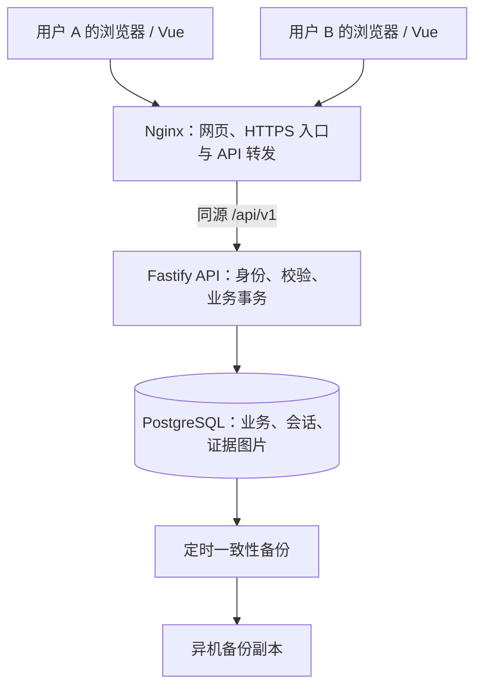
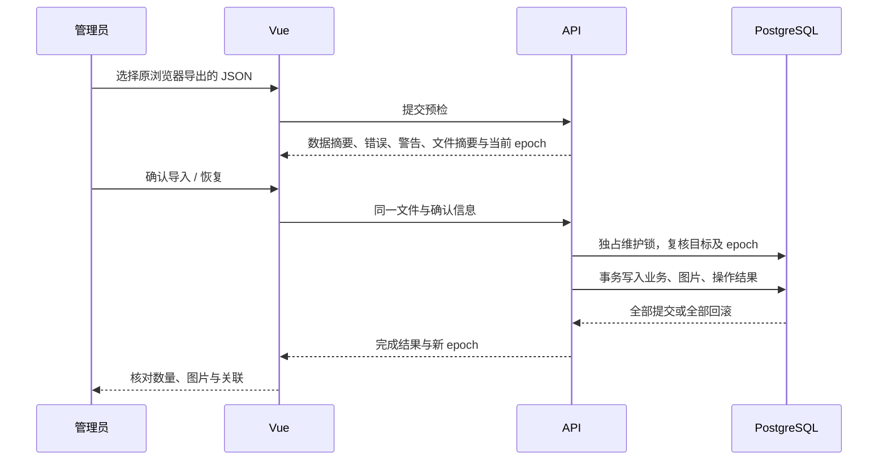

# PostgreSQL Backend Migration - Plan

## Goal Capsule

- **Objective:** 用户在不同电脑、浏览器登录后，可以查看和维护同一份账号及申诉数据，不再靠互相传递 JSON 文件同步。
- **Means:** 保留 Vue 页面，增加独立 API 服务，以 PostgreSQL 作为业务数据唯一来源；技术选型见 KTD1–KTD3。
- **Authority:** 用户明确要求先规划、使用 PostgreSQL。本文件中的框架、存储布局和运维指标是推荐方案，不代表已经实施或获得部署授权。
- **Execution profile:** 同一 Git 仓库、独立后端目录、单机 Docker Compose，先完整迁移现有能力，再考虑扩展。
- **Stop conditions:** 实际备份存在无法无损映射的数据，或需要删除、覆盖在线数据时，先报告并取得具体确认；不得猜测补齐或静默丢弃。
- **Ownership:** 后续开发负责实现和验证；用户确认数据源、正式域名及切换窗口后才能上线。当前交付只包含计划。

---

## Product Contract

### Summary

把当前浏览器本地工作台改为共享的在线工作台，保留 INS、Google、TikTok、Ping0 的现有桌面操作方式。
现有本地 JSON 备份通过一次迁移进入服务器，之后新增、编辑和删除均由后端保存。

### Problem Frame

当前 `src/data/database.ts` 使用 Dexie/IndexedDB，数据属于访问网站的浏览器及其来源地址，而不属于部署网站的服务器。
因此换电脑、换浏览器或改变端口后，看见的数据可能不同；部署 Docker 本身不会改变这一点。

当前 `src/auth/auth-service.ts` 在前端校验两个配置账号，并在 localStorage 保存登录身份。
这适用于此前的本地工具，但共享数据后，是否允许修改必须由 API 判断，不能只依靠按钮隐藏。

已有 `src/data/data-service.ts` 集中了业务读写，可以作为接入 API 的主要替换点，不需要重写整套界面。
旧计划 `docs/plans/2026-08-21-1739-feat-platform-appeal-manager-plan.md` 记录的是原始前端方案，不作为本次服务端设计约束。

### Requirements

**共享与权限**

- R1. 四个平台的数据统一保存在服务器 PostgreSQL；两个登录账号访问同一个工作区，不按登录账号各建一份数据。
- R2. 保留管理员和只读两种身份，各一个账号；管理员可维护数据，只读账号可查看、复制及导出，但不能新增、编辑、勾选完成、上传、删除或恢复数据。
- R3. 页面只有收到服务端成功响应才能确认保存成功；断网或服务不可用时明确报错，不退回本地保存并伪装成成功。
- R4. 在另一浏览器刷新或重新进入页面后能看到已提交数据；第一版不承诺打开页面后即时推送别人的修改。

**现有业务兼容**

- R5. 保留账号管理、申诉模块、步骤排序、申诉记录、批量操作、模板复制、证据图片、已勾选 IP 导出的现有能力和平台字段差异。
- R6. 账号批量导入允许缺项并报告缺失字段；手动新增和完整编辑沿用当前平台校验规则，不额外要求账号名唯一。
- R7. 一条申诉记录可含多条 IP 或网段，保持顺序、逐条完成标记和一对一验证账密；账密仍是一个可部分填写的文本字段。
- R8. IP 勾选与手动状态保持当前行为，不把“全部勾选”解释成“申诉成功”；准确转换规则见 KTD5。
- R9. INS 保留模板一、二、三，不恢复模板四；同一账号的模板姓名一致。迁移不更换用于生成姓名的账号 ID。

**迁移与持久性**

- R10. 支持现有 v1/v2 JSON 备份迁移，保留业务 ID、时间、关联、空字段、历史字段和证据图片；先预检，再明确确认并导入。
- R11. 批量写入和整库业务恢复必须原子提交；任何校验失败不能留下部分新数据，也不能先清空旧数据。
- R12. 同时编辑时不能静默覆盖他人的修改；版本冲突应提示刷新，并保留用户尚未保存的输入供核对。
- R13. 容器重建、应用重启后数据仍在；有自动数据库备份、异机副本和经过验证的恢复步骤。

### Scope Boundaries

第一版只做单工作区、两个账号和现有功能的在线化。登录密码进行基本哈希处理，但不引入复杂密钥管理；业务账号密码、2FA 和代理账密继续按现有产品要求可显示、可复制。

以下能力不在本次范围：

- 注册、找回密码、组织/租户管理、任意数量的用户和复杂角色配置。
- 离线可写和双向同步；这会引入两份主数据及冲突合并机制，与本次共享数据库目标不同。
- Redis、消息队列、微服务、Kubernetes、读写分离；当前两账号规模没有支持这些设施的证据。
- 自动访问代理验证 IP、自动提交申诉、执行模板中的技能；现有验证账密仍只是人工使用的信息。
- 自动部署到远程服务器、修改域名、推送代码；这些需要后续单独授权。

#### Deferred to Follow-Up Work

证据图片增长后可迁移到对象存储；需要秒级共享刷新时再增加推送；无法接受一天的数据损失时再配置 WAL 归档和时间点恢复。
不提前实现这些设施，但本次要使证据下载经过独立接口，避免页面绑定具体存储位置。

### Acceptance Examples

- AE1. Covers R1–R4：管理员在电脑 A 新增账号，只读用户在电脑 B 重新进入列表后能看到；直接调用写接口仍返回 403。
- AE2. Covers R7–R8：一条记录包含三个网段，勾选其中一个后该 IP 变绿；非终态记录变为“部分完成”。全部勾选也不会自动变为“申诉成功”。
- AE3. Covers R10–R11：导入包含账号、记录和图片的 v2 文件，任一图片损坏或关联不存在时，数据库原有业务数据保持不变。
- AE4. Covers R12：两个窗口编辑同一条记录，先提交者成功，后提交者收到冲突提示，不能覆盖前者的数据。
- AE5. Covers R13：重建 API 和 Nginx 容器后数据不变；在空数据库恢复备份后，数量、关联和图片校验和与备份时一致。

---

## Planning Contract

### Assumptions

- 第一版是小团队内部工具，部署在一台 Linux 服务器；并发量和图片总量尚未测量。
- 两个登录账号仍由维护者初始化和重置，不另做用户管理页面。
- 推荐保留现有前端框架和 Node 24，后端使用 TypeScript；用户尚未指定后端语言或框架。
- 建议备份目标为最多损失 24 小时数据、在 2 小时内恢复。它们是待实际演练验证的初始目标，不是当前系统已有保证。
- 完整备份的实际大小、图片总字节数、服务器内存、磁盘、域名和异机备份位置，在切换前确认；它们不阻塞编写后端，但阻塞正式上线验收。

### Key Technical Decisions

- KTD1. **使用 PostgreSQL 17 的受支持补丁版本。** 满足 R1、R11、R13。PostgreSQL 的事务、外键和并发控制适合当前账号—记录—图片关系；代价是需要真正的 API 服务和数据库运维。它不会让浏览器自动获得安全、可用的直连能力。官方版本政策中 17 仍受支持，计划支持到 2029 年；不使用 `latest` 自动跨大版本。
- KTD2. **后端采用 Node 24 + TypeScript + Fastify 5，数据层采用 Drizzle + node-postgres。** 与现有 TypeScript、Zod、Node 工具链一致。Fastify 提供路由、插件和测试入口；Drizzle 保留 SQL 可控性。第一版不引入 NestJS 的完整框架结构，也不更换前端。实施时锁定正式稳定依赖及兼容插件版本；Drizzle 当前部分官方示例使用 `@rc`，不得照搬到生产依赖。
- KTD3. **同仓库独立服务，不搬动现有 `src/`。** 新增 `server/` 与无浏览器依赖的 `shared/`；前端仍从根目录构建，后端有独立构建产物和 Dockerfile。根 npm workspaces 统一锁文件。只抽取确实两端共用的类型、校验和纯函数，不抽象通用后台框架。
- KTD4. **关系型存储业务数据，不把整个浏览器备份塞进一个 JSONB 字段。** 满足 R5–R7、R10。所有旧业务 ID 用 `text` 原样保留，新记录仍产生 UUID 字符串；旧备份只要求非空 ID，强制数据库 UUID 类型会造成不必要的不兼容。时间用 `timestamptz`，API 统一 ISO 8601 UTC，前端继续按本地时区展示。
- KTD5. **将现有 IP 状态转换提取为共享纯函数，并由后端最终执行。** 满足 R8。终态“申诉成功 / 申诉失败 / 已关闭”不因勾选改变；其他状态在至少一个 IP 勾选后为“部分完成”；清除最后一个勾选时，原“部分完成”回到“准备中”。手动单条或批量修改状态不自动改勾选集合。迁移不按勾选数重算历史状态。
- KTD6. **证据图片第一版直接存 PostgreSQL `bytea`。** 满足 R10–R13。当前单图上限 5 MiB、每记录 10 张，数据库存储能让记录删除、整库恢复和图片一起事务提交，一份数据库备份就覆盖图片。不采用“磁盘文件 + 数据库元信息”，以免第一版还需处理两个存储的备份时点和孤儿文件。代价是数据库及备份增长较快；上线前必须测量总量及恢复耗时，超过资源/恢复目标时先调整方案，不假定任何数据量都适合。
- KTD7. **采用服务端会话 Cookie，不再把前端 localStorage 当权限依据。** 满足 R2。登录密码使用成熟实现的 Argon2id 哈希；随机会话令牌只放 HttpOnly Cookie，数据库保存其摘要及到期时间。生产 Cookie 使用 Secure、SameSite，写请求校验 Origin/CSRF；同源部署不开放任意 CORS。默认会话绝对有效期 7 天，退出或重置密码后服务端失效。只读用户仍能读取业务凭据，这是产品权限选择而不是登录漏洞。
- KTD8. **写入使用实体版本校验与数据库事务。** 满足 R11–R12。可编辑实体有整数 `version`，更新和删除必须带期望版本；同一申诉记录的 IP、验证账密及证据变动都推进父记录版本。IP 子项按 ID 定向更新，不能把旧的整条记录覆盖回去。批量操作先按固定 ID 顺序锁定全部目标并校验平台、版本，再一次提交；任何冲突均整体返回 409。
- KTD9. **普通业务请求与整库恢复分开处理。** 满足 R10–R12。新建和批量导入采用操作 ID 与载荷摘要，事务内记录操作结果，网络超时后可查询或用同一操作 ID 重试，不重复插入。整库恢复改变 `dataset_epoch`，新执行的写入需携带当前 epoch，防止恢复前打开的表单写回恢复后的数据库；epoch 不从旧备份恢复。已完成操作的查询及重试结果按 Migration Contract 返回，不重新执行写入。
- KTD10. **SQL 迁移文件受版本控制，生产只应用已审查迁移。** 满足 R13。Drizzle 生成的 SQL 必须检查，生产不采用自动 schema push。迁移由单独的一次性任务执行并持有互斥锁；失败时不启动新应用，不让每个 API 实例争相迁移。

### High-Level Technical Design

Docker 负责封装和运行上述服务，数据库数据卷独立于容器生命周期。
Nginx 不负责保存数据；浏览器不连接 PostgreSQL，也不知道数据库密码。
开发时 Vite 固定 5176 并开启端口冲突报错，`/api` 代理到本机后端；生产只暴露网页入口，API 和数据库走容器内网。

预检不会修改业务数据。确认执行时重新验证内容，不能只相信前端的预检结果。

### Data Model

表名为拟新增结构，字段细节在建表时形成 schema；下表中的关联和兼容规则是必须保留的设计。

| 表 | 主要内容 | 关键约束 |
| --- | --- | --- |
| `users` | 登录用户名、密码哈希、角色 | username 唯一；角色只允许 admin/readonly，各一个，无注册接口 |
| `sessions` | 令牌摘要、用户、到期时间 | 关联 users；令牌摘要唯一；过期会话拒绝访问 |
| `accounts` | 平台、地区、账号、密码、邮箱、邮箱密码、2FA、token、decodeLink、备注、used、archived、version | 保留全部平台字段，即使当前界面不展示；账号名不设唯一约束 |
| `appeal_modules` | 平台、名称、说明、启用、排序、备注、归档 | 保留现有模块含义，不新建四套独立模块表 |
| `appeal_steps` | 平台、moduleId、名称、说明、排序、备注、归档 | 所属模块必须同平台；交换顺序在事务中完成 |
| `appeal_records` | 平台、国家、状态、申诉时间、申诉平台、可选账号/模块/步骤、备注、template1/2、归档、version | 保留已从 UI 隐藏的旧 moduleId/stepId；状态限当前八种 |
| `appeal_record_ips` | recordId、原始规范化文本、顺序、completed、verificationContent、旧验证字段兼容数据 | 同记录内文本唯一；验证账密和完成状态以子项 ID 关联，不以表格行号关联 |
| `record_evidence_images` | 平台、recordId、文件名、MIME、字节数、SHA-256、bytea、时间 | 随记录级联删除；列表不加载图片二进制 |
| `operation_receipts` | 操作 ID、种类、用户、epoch、载荷摘要、结果摘要 | 同一操作 ID 不接受不同载荷；用于新建、批量导入和恢复的重试确认 |
| `workspace_state` | 单工作区标识、dataset_epoch | 恢复时更新；用于拒绝过期页面的写请求 |

所有业务表保留 `createdAt/updatedAt/archived` 的对应字段。常用索引覆盖平台与排序时间、账号/模块关联、记录 IP 顺序、证据 recordId、会话到期时间。
对于平台关联，采用父表 `(platform_id, id)` 唯一约束和子表复合外键；记录的 stepId 还须属于它的 moduleId，不能只检查“步骤存在”。
被记录或步骤引用的账号、模块、步骤拒绝物理删除，提示归档；未被引用者才允许删除。数据库约束作为最终保障，不依赖前端先调用 `isReferenced`。

IP 以文本保存当前显示形式，校验复用现有 IPv4/IPv6/CIDR 逻辑；短写网段在快速导入解析层转换，不直接依赖 PostgreSQL `cidr` 的规范化结果作为显示文本。
同一语义的两种合法写法不自动合并，避免改变旧完成标记的匹配结果。新增 IP 默认未完成、无验证账密；移除 IP 同时移除它的附属字段，保存前明确告知。
旧验证账密的 `content` 和 `ip/account/password` 可能同时存在，导入时分别保留，不能因自由文本优先展示而丢弃旧字段。
旧字段放在 IP 子项的兼容 JSONB 中，保存原始值及字段存在性；这不是整库 JSON 存储。显示与复制继续使用现有 `verificationIpCredentialContent` 的优先级，未经编辑的账密导出时还原原字段。
用户在新弹窗主动修改后，以新 content 为权威并清空该子项的旧字段，避免旧值覆盖新输入；完整 IP 可提取时检查网段归属，无法提取时仍允许部分文本。

### API Contract

统一前缀 `/api/v1`。请求、成功响应、分页和错误结构在 `shared/` 定义，服务端实现后产出可验证的 OpenAPI 文档。
接口按业务划分，不为四个平台复制四套后端；平台是明确的路径参数并在每次查询和写入中校验。

| 接口组 | 能力 | 权限与一致性 |
| --- | --- | --- |
| `auth` | 登录、当前身份、退出 | 登录有限速；响应不包含密码哈希或会话摘要 |
| `platforms/:platform/accounts` | 查询、详情、新增、编辑、失效标记、归档、删除、批量导入 | 读操作两角色可用；写操作管理员；批量导入与手动表单用不同校验入口 |
| `platforms/:platform/modules`、`steps` | 列表、CRUD、归档、排序 | 校验引用和平台；排序原子提交 |
| `platforms/:platform/records` | 列表、详情、CRUD、快速导入、批量状态、批量删除 | 状态仅修改状态，不能顺带覆盖 IP 或备注 |
| `records/:id/ips`、验证账密批量操作 | 勾选、取消、修改验证文本、快速匹配导入 | 校验父记录版本、网段归属；未匹配与多候选报告，不自行猜选 |
| `records/:id/evidence` | 图片元数据、上传、取二进制、删除 | 两角色可看，管理员可写；持父记录锁检查数量，防止并发突破上限 |
| `summary`、国家选项、账号选择、完成 IP 导出 | 概览、筛选选项、关联账号查找、导出 | 独立于当前页面分页，不以本页数据充当全量统计 |
| `backups`、`imports`、操作查询 | 业务 JSON 导出、预检、确认迁移/恢复、查询操作结果 | 导出可只读；写入管理员；整库恢复按 Migration Contract 执行 |

列表由服务端分页、筛选和排序，账号页默认仍为 10 条；排序加 ID 作为稳定的第二排序键。
页面关联账号从详情或查找接口获取，不能只在当前账号页内寻找。现有统计标签、全量国家选项和“导出所有已勾选 IP”不得因分页缩小范围。
错误至少区分 401 未登录、403 无写权限、404 不存在、409 版本/引用/操作冲突、422 校验失败、413 超出请求大小、503 暂不可用，并返回可定位字段或导入行的信息。

普通 JSON 请求默认限 1 MiB；批量数据请求限 10 MiB；完整备份导入沿用现有 100 MiB 文件上限，使用单独路由设置，Nginx 上限另留封装余量。
图片接口按现有 5 MiB/张、10 张/记录校验，整批上传全成或全败。超过限制必须在提交前和服务端明确报错，不自动截断或分批形成半成功结果。
请求大小、超时和连接池限制通过部署配置管理，实施阶段依据实际备份和服务器内存做验证。

### Frontend Integration

保留 `dataService` 门面，但把持久化实现改成 API 客户端；分页返回类型、版本字段和服务端错误需显式调整调用点，不能承诺“页面一行不改”。
`shared/` 不依赖 Vue、DOM 或 Dexie。模板构造、表格文本解析、完成 IP 导出等纯逻辑尽量保留；授权、最终校验和状态转换必须在服务端执行。

登录改为异步流程，路由初始化先请求当前身份；不继续信任旧 localStorage 会话。
列表请求在平台或筛选改变时取消旧请求，或校验请求标记再应用响应，防止慢响应把 INS 数据展示到 Google 页面。
页面显示明确的加载、空数据、请求失败三种状态；401 重新登录，403 禁止写入，409 保留表单并提示重新获取最新版本。

旧 IndexedDB 只保留在显式的“旧浏览器数据导出”过渡入口，不参与线上普通读写。检查 Dexie 直接导入、初始化迁移、测试注入等旁路，防止仍有页面写本地数据库。
不得自动上传每个访客浏览器的数据，也不得清空原浏览器作为迁移的一部分。

### Migration Contract

1. **确定唯一来源。** 用户在目前确实有完整数据的原浏览器、原地址导出 v2 JSON，包含证据图片。若 5174、5176 或不同设备各有不同数据，分别导出并人工确定主版本；第一版不做自动合并。
2. **预检。** 检查 v1/v2 格式、大小、各表 ID 重复、跨平台/悬空关联、时间、IP 顺序与完成标记、验证账密、图片 MIME/字节数/校验和。报告各平台各实体数量、图片总字节数及字段缺失，不只给“验证通过”。
3. **兼容性处理。** 保留非 UUID ID 和缺字段账号；保留 used、token、decodeLink、archived 与旧流程引用。旧数据超过现有图片限制或存在无法映射项时给出逐项问题，先人工处理再导入，不静默删图、断开关联或改状态。
4. **首次导入。** 目标业务表必须为空；初始化的 users/sessions 不算业务数据。使用文件摘要、操作 ID 和目标 epoch 防止误重复。与确认信息不一致则重新预检。
5. **事务执行。** 图片解析和格式验证在写事务前完成；提交时取得全局事务级独占维护锁，再次检查目标为空及 epoch。按外键依赖顺序写入全部业务和图片，记录结果后一起提交。
6. **恢复已有在线数据。** 保留现有“全量替换”的能力，但明确提示影响全部用户及四个平台。需维护窗口、刚生成且验证可用的数据库备份、管理员二次确认；再用同一事务替换所有业务数据。普通写事务取得共享维护锁，恢复独占锁等完在途写入后复核，故不会夹入新修改。
7. **切换检查。** 对比每表、每平台数量和业务 ID 集合，抽查关联、模板姓名、IP 勾选及图片哈希；新浏览器登录检查。通过后停止旧版本写入，以服务器为唯一来源。

业务 JSON 不包含登录账号、会话、操作回执或旧 epoch；恢复不替换这些系统信息。恢复完成轮换 epoch，旧页面必须刷新。
网络中断时，通过操作查询确认是否已经提交，不能看到超时就认定数据库回滚。
API 先认证、授权并核对操作归属；若该操作已完成且载荷一致，返回已存结果并注明其提交 epoch，不再次写入。只有尚未执行的操作才检查当前 epoch；因此恢复成功但响应丢失时，旧 epoch 仍能用于取回此次操作结果，而不能用于新写入。
业务读取返回的数据、实体版本和 epoch 必须来自同一数据库快照；列表刷新、恢复完成和会话重建后清理旧选择及缓存。不能把恢复前读到的数据搭配恢复后的 epoch 交给编辑表单。
备份导出使用只读一致性快照，从数据库拼回兼容 v2 的多行 IP、completedIps、verificationIps 和 base64 图片；业务 JSON 仍限制 100 MiB，超过时明确引导使用运维数据库备份，不生成缺图片的“完整备份”。

### Deployment and Recovery

持续运行的容器为 Nginx、API、PostgreSQL；数据库迁移为一次性任务，备份为宿主机定时任务或定时调用的工具容器。
数据库使用命名卷；重建应用不删除卷，不使用带删除卷选项的停止步骤。
数据库和 API 不向公网直接映射端口；数据库访问参数只存在服务器运行配置中。

API 提供存活和就绪检查；就绪检查验证数据库连通及 schema 版本，不能只返回固定 200。数据库断连时写入失败并提示，恢复连通后连接池可恢复使用。
Nginx 的 `/api/` 请求必须转发给 API，API 的 404/500 不允许落入前端 history fallback；API 响应不缓存。
保持现有静态资源缓存和路由回退，使用同源路径以兼容现有 CSP；正式 HTTPS 在该入口或已有上游代理终止，部署文档只能指定一处责任方。

首次启动通过独立初始化命令读取服务器环境配置，创建两个用户并存哈希；再次启动不重置密码。维护者使用专用命令重置，重置后撤销对应会话。
移除前端 `VITE_*PASSWORD` 构建参数，调整 `src/auth/auth-config.ts`、Dockerfile、Compose、CI 与说明文档。
当前 `.env.local` 实际受 Git 跟踪，不能只新增 `.gitignore` 后声称已忽略；实施时移除其跟踪并保留本机文件，新增无真实密码的示例配置。不在本次规划中改动文件或重写 Git 历史。

采用 PostgreSQL 自带一致性逻辑备份，建议每日一次，保留 7 份日备份和 4 份周备份，并复制至另一台机器或备份存储。
备份覆盖业务表、证据 bytea、schema 和系统数据；数据库角色及部署配置单独留存恢复说明。备份失败要有非零退出、日志及明确通知渠道，不能只有无人查看的文件。
每次数据库变更前额外备份；上线前和之后定期在独立空数据库完成恢复演练。恢复时先停写、验证备份、恢复、检查，再开放流量；全库灾难恢复后清理会话并轮换 epoch。

数据库备份不能直接用复制正在运行的数据目录代替。版本升级保持补丁更新可控，跨 PostgreSQL 大版本另做迁移演练。
旧前端可作为切换前回退方案，但服务器接受新写入后，不能简单切回旧 IndexedDB 版本，否则新数据会分叉；此时需停写、保存服务端新数据，并用已验证的应用/数据库恢复方案回退。

### Risks and Dependencies

| 风险 | 处理方式 | 上线前证据 |
| --- | --- | --- |
| 原数据分散在不同浏览器或端口 | 用户指定主数据文件，其他保留独立备份 | 主备份来源和逐平台统计已确认 |
| 图片导致备份大、恢复慢 | KTD6；列表不查 bytea，备份流式处理，测峰值内存 | 实际体量的导入、导出及恢复记录 |
| 修改一个字段覆盖了其他窗口内容 | KTD8–KTD9 | 双窗口冲突及恢复后旧表单测试 |
| 删除产生悬空账号/模块/步骤 | 外键与归档规则 | 服务端直接调用也无法破坏关联 |
| 现有浏览器测试只注入 Dexie | 转为 API/真实 PostgreSQL 测试夹具 | 不依赖本地 DB 的完整端到端通过 |
| 文档示例或依赖使用预发布版 | 锁定正式版本，检验 Node 24/TS 6 兼容性 | 锁文件、构建与集成测试通过 |
| 单机磁盘损坏 | 持久卷加异机备份；卷不是备份 | 异机副本可下载并完成恢复 |

---

## Implementation Units

以下路径中 `server/`、`shared/` 及新测试均为拟新增，其余为现有文件。按 U-ID 依赖推进，不在任一半成品阶段切换正式数据。

### U1. Service Foundation

**Goal:** 建立能独立构建、连接 PostgreSQL 并报告健康的后端。

**Requirements:** R1、R13。**Dependencies:** 无。

**Files:** `package.json`、`package-lock.json`、`tsconfig*.json`；新增 `server/package.json`、`server/tsconfig.json`、`server/src/app.ts`、`server/src/config.ts`、`server/src/db/connection.ts`、`server/tests/health.spec.ts`、`shared/package.json`。

**Approach:** 按 KTD1–KTD3 建立服务边界，锁定依赖；配置缺失即启动失败。使用共享连接池、请求 ID 和不记录请求凭据的结构化日志。

**Test scenarios:**

- 合法配置连接测试 PostgreSQL，就绪检查成功；连接错误则明确失败。
- 数据库不可用时存活与就绪状态有区别，恢复连接后可继续请求。
- 前端构建不包含数据库驱动、连接串或 server 产物。

**Verification:** 两端独立构建可用，空服务通过真实数据库连接测试。

### U2. Schema and Shared Contracts

**Goal:** 固定关系、校验与迁移规则，使旧数据可以无损映射。

**Requirements:** R5–R10、R12。**Dependencies:** U1。

**Files:** 新增 `server/src/db/schema.ts`、`server/drizzle.config.ts`、`server/migrations/`、`shared/src/domain/`、`shared/src/api/`、`server/tests/schema.spec.ts`、`shared/tests/record-status.spec.ts`；调整 `src/domain/entities.ts`、`src/domain/validation.ts`、`src/domain/account-fields.ts`。

**Approach:** 实现 KTD4–KTD6 和 Data Model。共享领域校验不导入浏览器模块，前端兼容导出原有符号；迁移 SQL 经审查后纳入版本控制。

**Test scenarios:**

- 非 UUID 旧 ID、缺字段账号、TikTok 扩展字段和历史引用能保存并读回。
- 跨平台关联、步骤与模块不匹配以及删除被引用实体均被拒绝。
- 三个 IP 的顺序、部分账密及取消最后一次勾选符合 R7–R8。

**Verification:** 全新 PostgreSQL 可按迁移创建 schema，重复执行不重复建表；约束由真实数据库测试证明。

### U3. Server Authentication

**Goal:** 两个共享工作区账号在所有 API 上具有一致的真实权限。

**Requirements:** R2。**Dependencies:** U1、U2。

**Files:** 新增 `server/src/auth/`、`server/src/commands/bootstrap-users.ts`、`server/src/commands/reset-password.ts`、`server/tests/auth.spec.ts`。

**Approach:** 实现 KTD7；服务端统一认证及只读写入拦截。初始化只在缺少用户时创建，不因容器重启覆盖已有哈希。

**Test scenarios:**

- 正确登录、错误密码、会话到期、退出、重置密码使旧会话失效。
- 修改本地角色或伪造请求体角色不能取得写权限。
- 只读用户请求所有业务写路由均为 403，读取与导出可用。
- 连续失败登录和非同源写请求被拒绝。

**Verification:** 权限由直接 API 测试证明，不依赖 UI 按钮状态。

### U4. Business API and Transactions

**Goal:** 为四个平台提供完整业务读写及稳定分页。

**Requirements:** R5–R9、R11–R12。**Dependencies:** U2、U3。

**Files:** 新增 `server/src/features/accounts/`、`server/src/features/modules/`、`server/src/features/steps/`、`server/src/features/records/`、`server/src/features/summary/`、`server/src/operations/`、`server/tests/business.spec.ts`、`server/tests/concurrency.spec.ts`。

**Approach:** 按 API Contract 分模块，复用现有解析纯函数；实现 KTD8–KTD9、引用约束和全量统计。先写并发与批量事务测试，再实现持久化路径。

**Test scenarios:**

- Covers AE2：逐条标记只影响指定 IP，状态转换与手动批量状态互不混淆。
- Covers AE4：相同旧版本更新只允许一次成功；冲突批量请求所有数据不变。
- 批量请求混入已删除或其他平台记录时整体失败。
- 新建已提交但响应丢失，再用同一操作 ID 重试不生成第二份数据。
- 超出一页的账号、国家筛选和完成 IP 导出仍覆盖正确的全集。

**Verification:** 全部业务路由可直接通过 API 完成，并能在真实数据库验证原子性。

### U5. Evidence Storage

**Goal:** 图片在线共享且与记录生命周期一致。

**Requirements:** R5、R10–R13。**Dependencies:** U4。

**Files:** 新增 `server/src/features/evidence/`、`server/tests/evidence.spec.ts`；调整 `src/features/appeal-records/RecordEvidenceImagesDialog.vue`。

**Approach:** 实现 KTD6，单独上传/下载路由；上传校验真实可解码图片及类型，拒绝伪装文件，遗留特殊格式在迁移预检中明确处理。元数据列表不包含图片 bytes，详情按需加载。

**Test scenarios:**

- 多张图上传、刷新后查看、删除，数据库字节与文件哈希一致。
- 已有九张图时两个并发上传不能让总数超过十张。
- 图片无效、过大或父记录不存在时整个上传事务不留下部分图片。
- 删除记录时对应 IP 子项与图片一起删除，只读用户不能上传或删除。

**Verification:** 图片可跨浏览器读取，父记录事务与数据库备份均覆盖原图。

### U6. Backup Import and Restore

**Goal:** 将现有 JSON 一次迁移到在线工作区，并保留明确的恢复能力。

**Requirements:** R10–R13。**Dependencies:** U4、U5。

**Files:** 新增 `shared/src/backup/`、`server/src/features/backups/`、`server/tests/backup-migration.spec.ts`、`server/tests/restore-concurrency.spec.ts`；调整 `src/features/backup/backup-service.ts` 及其现有测试。

**Approach:** 按 Migration Contract 实现预检、确认、事务导入、快照导出和操作查询；以脱敏 v1/v2 夹具证明字段及 ID 不丢失。维护锁协议在所有业务写入入口生效，不只在恢复路由中使用。

**Test scenarios:**

- Covers AE3：损坏图片、重复 ID、跨平台引用均阻止提交，旧数据不变。
- v1 无图片与 v2 有图片分别导入后导出，业务语义与字节哈希一致；同时含 content 与旧 ip/account/password 的账密未经编辑时完整保留。
- 两个首次导入同时发生，只能有一个成功；重复同一操作不产生重复数据。
- 恢复与普通写入并发时不夹写；恢复前表单用旧 epoch 提交得到冲突。
- 恢复已提交但响应丢失后，同一操作能查询到成功结果，而携带旧 epoch 的另一新操作不能写入。
- 文件接近 100 MiB 时不超资源预算，超过上限明确拒绝，导出不漏图片。

**Verification:** 脱敏备份迁移及回环验证通过；真实数据只在获授权的切换窗口操作。

### U7. Frontend Cutover

**Goal:** 保留桌面工作流，将所有持久化及登录切到 API。

**Requirements:** R1–R9、R12。**Dependencies:** U3–U6。

**Files:** `src/data/data-service.ts`、`src/data/database.ts`、`src/data/local-record-migration.ts`、`src/auth/auth-service.ts`、`src/auth/auth-config.ts`、`src/auth/LoginView.vue`、`src/router/`、`src/features/`、`vite.config.ts`；新增 `src/data/api-client.ts`、`src/data/__tests__/api-client.spec.ts`、`tests/e2e/shared-data.spec.ts`、`tests/e2e/api-failures.spec.ts`；调整现有 `tests/e2e/` 夹具。

**Approach:** 按 Frontend Integration 改造门面、分页及 UI 请求状态；模板逻辑保留稳定账号 ID。备份页面改为“共享数据备份与恢复”，文案不再声称“不会上传到服务器”。

**Test scenarios:**

- Covers AE1：独立浏览器上下文共享记录且只读用户不能修改。
- 网络错误、会话过期、保存冲突均不会显示保存成功或写入 IndexedDB。
- 快速切换平台时旧响应不能覆盖新页面；编辑中冲突仍保留用户输入。
- INS 三模板及同账号姓名、TikTok 模板、验证账密导入、已勾选 IP 导出、十条分页全部回归。

**Verification:** 现有业务 E2E 改为使用真实 API 后通过；没有普通业务本地写入旁路。

### U8. Deployment and Release Validation

**Goal:** 形成可重建、可备份、可恢复的单机部署包。

**Requirements:** R13，并验证 R1–R12。**Dependencies:** U1–U7。

**Files:** `Dockerfile`、`deploy/nginx.conf`、`deploy/docker-compose.example.yml`、`.dockerignore`、`.gitignore`、`.github/workflows/ci.yml`、`tests/smoke/container-smoke.mjs`、`docs/DEPLOYMENT.md`、`docs/SECURITY.md`、`README.md`；新增 `server/Dockerfile`、`deploy/.env.example`、`deploy/backup/`、`tests/smoke/full-stack-smoke.mjs`。

**Approach:** 实现 KTD10 与 Deployment and Recovery。CI 增加真实 PostgreSQL 集成测试和全栈容器烟测，继续区分 CI 验证与实际部署；不新增未经授权的自动远程发布。

**Test scenarios:**

- Covers AE5：容器重建数据仍在，空库恢复后业务及图片校验通过。
- 数据库迁移失败时新 API 不接受请求，API 错误不会返回网页 HTML。
- 数据库端口不暴露公网，前端构建中没有数据库参数或登录密码。
- 定时备份失败可被维护者发现；异机副本可恢复，实际时间达到约定目标。

**Verification:** 测试环境完成全栈启动、业务烟测、备份恢复与回退演练后，提交正式切换检查表供确认。

---

## Verification Contract

本次只规划，不运行测试、不声称已完成后端验证。下列是实施后的质量门槛。

| 层级 | 验证方式 | 完成信号 |
| --- | --- | --- |
| 现有代码质量 | 保留 `npm run lint`、`npm run format:check`、`npm run build` | 前端与 shared 无类型/构建回归 |
| 领域逻辑 | 延续 `npm run test:unit` 并纳入共享纯函数测试 | 平台字段、IP 解析、模板姓名、状态、导入规则覆盖 |
| 后端集成 | 新增 API 与真实 PostgreSQL 测试入口 | 外键、角色、事务、版本冲突、操作重试、维护锁有效 |
| 浏览器业务 | `npm run test:e2e` 改为全栈环境 | 现有桌面功能和两个浏览器共享场景通过 |
| 容器 | 扩展 `npm run test:container` | Nginx 转发、就绪、持久卷、完整业务烟测通过 |
| 数据迁移 | v1/v2 脱敏备份及授权后的主备份 | 各表数量、ID、关联、IP 标记、模板姓名、图片哈希一致 |
| 运维恢复 | 独立空库恢复与异机副本验证 | 可操作的恢复记录及实际耗时，满足确认后的目标 |

测试 PostgreSQL 与生产使用同一大版本，不以 SQLite 或 mock 数据库替代事务证明。
端到端测试使用隔离测试库与测试账号，不能复用生产数据库。真实备份和凭据不进入仓库或 CI 夹具。

---

## Definition of Done

- R1–R13 均有对应验证，U1–U8 的完成信号全部满足。
- 两个不同浏览器能读写同一份服务端数据，不需要相互导入 JSON。
- 原功能无静默删减，旧数据迁移有清晰预检结果及逐项核对记录。
- 失败不会留下部分写入，也不会退回本地数据制造“两份真相”。
- 部署、迁移、密码初始化、备份、恢复和回退步骤齐全，已在测试环境演练。
- 清理弃用的前端凭据配置、废弃 API 试验实现及双写路径；仅保留有明确用途的旧数据导出工具。
- 正式切换前确认主数据、域名、备份位置和维护窗口；文档完成或 CI 通过本身不等于已上线。

---

## Appendix

### Repository Evidence

- `src/domain/entities.ts`：四类业务实体、八种状态、验证账密和 Blob 证据图片定义。
- `src/domain/account-fields.ts`：各平台字段不同，TikTok 另有 token、decodeLink，不能仅按早期聊天字段建表。
- `src/domain/validation.ts`：批量导入与手动录入校验不同；账密部分填写、IPv6、网段归属等已有规则。
- `src/data/data-service.ts`：批量状态/删除事务、关联校验、归档、图片上限、replaceAll/exportAll；可作为 API 迁移边界。
- `src/features/appeal-records/AppealRecordsView.vue`：toggleIpCompleted 的状态规则，以及账号、验证账密、批量操作入口。
- `src/features/appeal-records/instagram-template.ts` 及其测试：姓名受 nameKey 影响；保留账号 ID 是迁移一致性的组成部分。
- `src/features/backup/backup-service.ts`：v1/v2 格式、100 MiB 限制、base64 图片、旧 ID 只要求非空。
- `src/auth/auth-service.ts`、`deploy/nginx.conf`、`Dockerfile`、`vite.config.ts`：当前本地身份、静态部署和 5176 开发端口。

### External References

以下官方文档用于约束本方案，查阅于 2026-10-09。实施时仍需核对最终锁定版本。

- [Fastify LTS](https://fastify.dev/docs/latest/Reference/LTS/)：KTD2 的受支持 Node/Fastify 版本选择。
- [Drizzle PostgreSQL](https://orm.drizzle.team/docs/get-started-postgresql)：KTD2 的 node-postgres 接入；注意当前页面预发布示例。
- [Drizzle migrations](https://orm.drizzle.team/docs/migrations)：KTD10 选择 SQL 迁移文件，而不是生产 schema push。
- [PostgreSQL version policy](https://www.postgresql.org/support/versioning/)：KTD1 的大版本支持周期。
- [PostgreSQL binary data](https://www.postgresql.org/docs/17/datatype-binary.html)：KTD6 使用 bytea 存原图字节。
- [PostgreSQL explicit locking](https://www.postgresql.org/docs/17/explicit-locking.html)：KTD8 及维护锁的事务、锁顺序设计。
- [PostgreSQL SQL dump](https://www.postgresql.org/docs/17/backup-dump.html)：数据库备份的一致性快照、恢复及角色前置条件。
