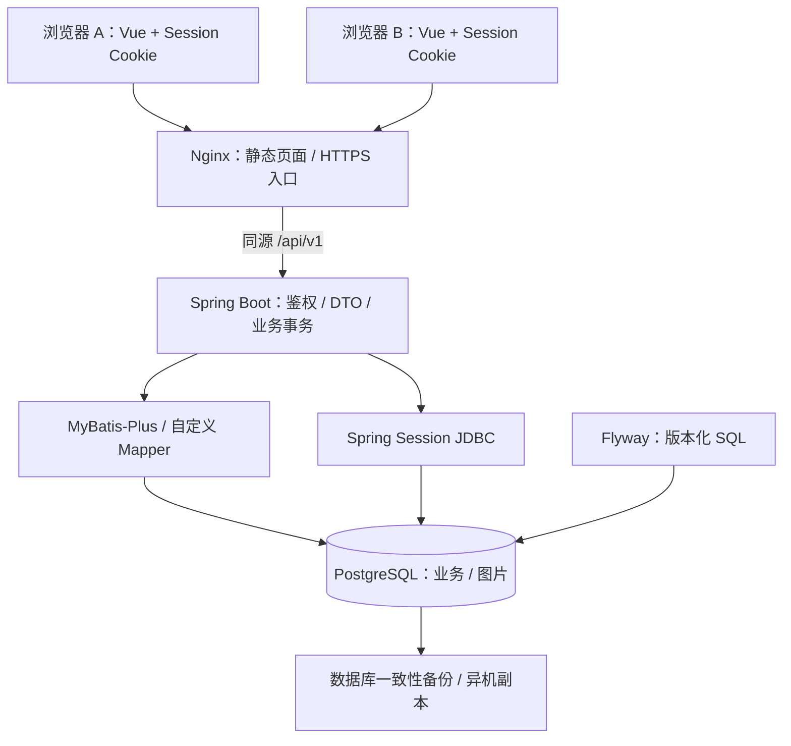
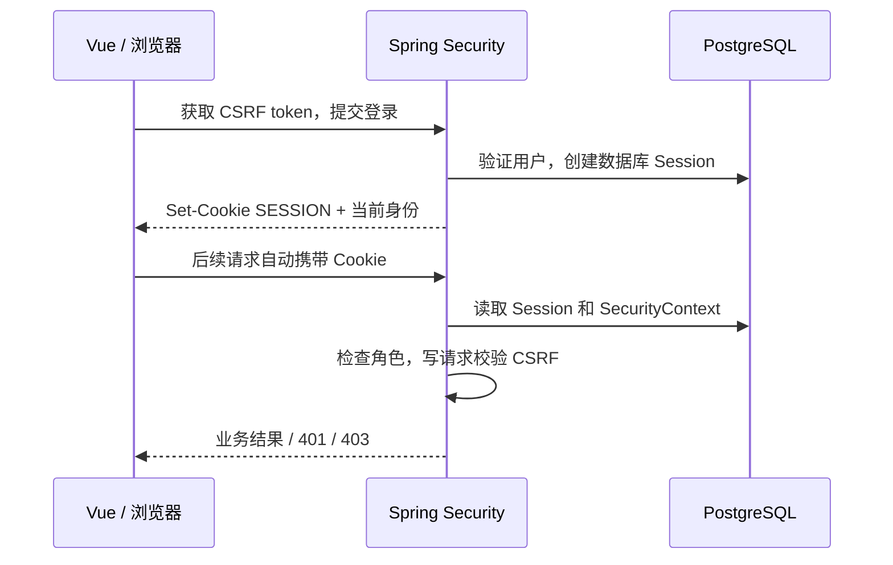
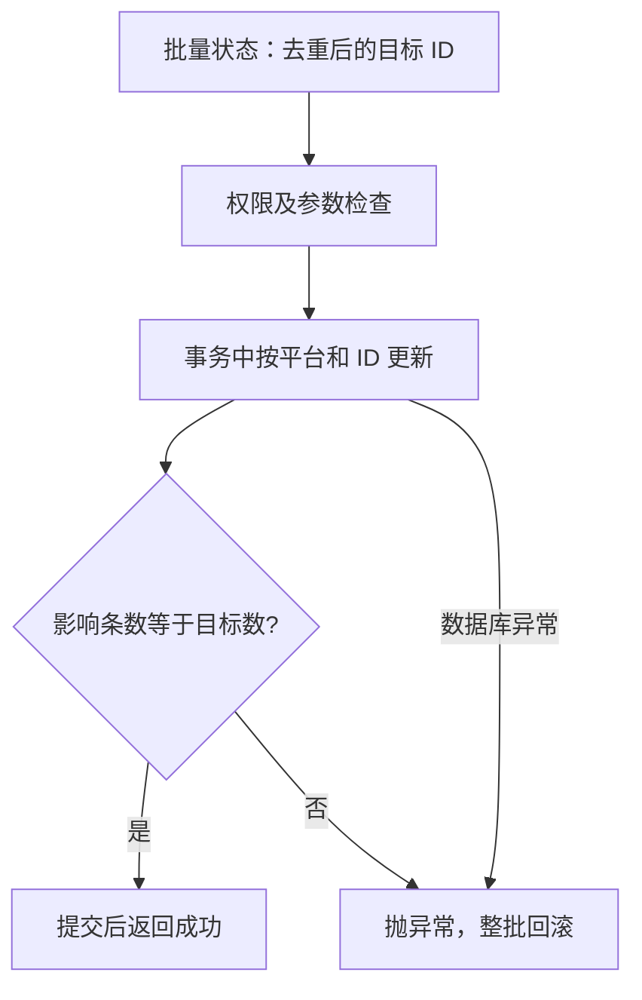

# Spring Boot PostgreSQL Backend - Plan

平台申诉管理台 Java 后端计划书。本文以本次逐项讨论的决定为准，取代 `docs/plans/2026-10-09-1843-feat-postgresql-backend-plan.md` 中的 TypeScript 后端方案；旧文件只作历史参考。
下文类名、方法名、表名和新接口均为拟定设计，不表示代码已经存在。

## Goal Capsule

- **Objective:** 用户在不同电脑、浏览器登录后，能够查看和维护同一份账号、申诉记录、验证账密及证据图片。
- **Means:** 保留 Vue 前端，增加 Java / Spring Boot 单体后端，使用 MyBatis-Plus、PostgreSQL、Spring Session JDBC 和 Flyway，见 KTD1–KTD5。
- **Authority:** 用户已确认的产品规则见 R1–R19；技术设计不得重新引入已否决的账号归档、普通编辑乐观锁、自动轮询或独立迁移接口。
- **Execution profile:** 同仓库独立 `backend/`，分八个实施单元完成，在测试环境验证后再安排正式切换。
- **Stop conditions:** 旧备份无法无损恢复、必须改变既定业务规则、或需要覆盖正式数据时先报告；不得猜测修复、静默丢弃或自行上线。
- **Ownership:** 本次只交付计划。实现、运行测试、真实数据恢复、Git 提交和远程部署均不在本次执行范围内。

---

## Product Contract

### Summary

数据库成为共享业务数据的唯一来源，浏览器只负责界面、编辑草稿、复制和展示。
账号管理、申诉模块、步骤及记录继续使用当前桌面页面，保留四个平台的字段和操作差异。
登录和权限转移到后端；完整 JSON 备份恢复同时承担首次数据导入，不另建迁移系统。

### Problem Frame

当前 Dexie 数据属于浏览器及其来源地址；部署静态网站不会让这些数据自动进入服务器。
目前登录身份保存在 localStorage，权限检查在前端，无法作为共享 API 的访问控制。
`src/data/data-service.ts` 已集中大部分持久化操作，适合作为 API 接入边界；分页、图片、备份和鉴权仍需要调整调用页面，不能承诺只改一个文件。

### Actors

- A1. 管理员：查看、复制、导出和所有业务写入，包括完整恢复。
- A2. 只读账号：查看四个平台的完整业务信息、复制和导出，包括完整备份；不能新增、修改、删除、上传、勾选 IP 或恢复备份。
- A3. 部署维护者：配置两个登录账号、数据库连接、HTTPS 和数据库备份；不增加在线注册或用户管理页面。

### Requirements

**共享和登录**

- R1. 保留 Vue 与四个平台，两个登录账号共用一个工作区；不按登录账号划分数据副本。
- R2. 后端实施 A1/A2 权限，前端隐藏按钮仅作为辅助，所有新增 API 同样受权限控制。
- R3. 使用 HttpOnly Cookie 携带 Session ID，PostgreSQL 保存 Session；连续 8 小时未访问会话后失效，正常会话访问延长空闲期限。
- R4. 退出只注销当前会话；同一浏览器共享该会话的标签页退出，其他设备的会话保留。
- R5. 进入页面、改变平台或筛选分页、自己保存成功以及手动刷新时重新加载；不轮询，不增加 WebSocket/SSE。

**账号与申诉工作流**

- R6. 业务账号物理删除，关联申诉记录保留并解除账号关联；账号不使用归档或逻辑删除工作流。
- R7. 账号批量导入允许相同账号重复新增，每条拥有独立 ID；缺少字段提示但不因手动表单必填规则阻止导入。
- R8. 模块、步骤、排序、原有引用及归档行为保留；R6 的变更只针对业务账号，不自动扩大到模块和步骤。
- R9. 普通编辑采用后写覆盖，不比较客户端请求时间或实体版本；只覆盖本次提交的字段，不把整个陈旧页面对象写回数据库。
- R10. 批量修改状态必须全部成功才提交，任一目标缺失或平台不匹配则整批撤销；仅更新状态，不改变 IP 完成标记。
- R11. IP/CIDR 每行一个，保留顺序和逐 IP 绿色勾选；非终态有勾选则为“部分完成”，取消最后一个勾选时原“部分完成”回到“准备中”，终态不因勾选改变，全部勾选也不自动成功。
- R12. 保留申诉记录快速导入：国家加网段列表，每条记录容纳的网段数可输入正整数；沿用现有短网段转换、去重、报错和分组行为。
- R13. 验证 IP 账密保持每网段一个可部分填写的文本字段；快速导入按现有网段匹配更新，未涉及项保留，同批同网段取最后一条。整表导入覆盖当前平台全部记录中包含该匹配网段的项，不限当前分页。
- R14. 保留 INS 模板一至三、同账号固定姓名及 TikTok 模板，不恢复 INS 模板四；保留复制、平台外链及现有桌面布局。
- R15. 导出当前平台所有已勾选变绿的 IP，内容为“国家＋IP”，不是导出选中的记录或只导出当前页。

**图片、备份和上线**

- R16. 图片完整内容存 PostgreSQL `bytea`，保持单图 5 MiB、单记录 10 张的现有限制；跨浏览器登录后可查看，删除记录时一起删除。
- R17. 保留完整 JSON 导出及恢复，兼容当前 v1/v2 备份；恢复整体替换四个平台业务和图片，不合并，不替换登录用户、Session 或 Flyway 信息。
- R18. 改造前保存含图片的当前 JSON，切换前若源数据变化则重新导出；首次导入复用恢复接口，不提供 `/api/v1/migrations/local-backup`。
- R19. 应用重启或重建容器后数据仍在；网络或数据库故障不回退到 IndexedDB 假装保存成功，服务器有独立数据库备份和恢复说明。

### Key Decisions

- **账号直接删除但保留申诉记录。** Governs R6。（session-settled: user-directed — chosen over cascade deletion and account archival: 删除账号不应抹掉申诉历史。）
- **账号允许重复新增，验证账密匹配覆盖。** Governs R7, R13。（session-settled: user-directed — chosen over one duplicate policy for both imports: 两个功能含义不同，后者保持原逻辑。）
- **批量状态整批回滚。** Governs R10。（session-settled: user-directed — chosen over partial success: 用户权衡后选择一次操作结果一致。）
- **后写覆盖，不加版本冲突拦截。** Governs R9。（session-settled: user-directed — chosen over optimistic locking: 以数据库实际写入顺序接受较后的修改。）
- **只读可导出完整备份。** Governs R2, R17。（session-settled: user-directed — chosen over admin-only export: 导出属于读取，恢复属于修改。）
- **八小时空闲超时、当前会话退出、手动刷新。** Governs R3–R5。（session-settled: user-directed — chosen over shorter idle timeout, all-device logout and polling: 已分别比较并选定。）
- **保留恢复能力，取消专门迁移接口。** Governs R17, R18。（session-settled: user-directed — chosen over separate empty-database migration: 同一个兼容旧 JSON 的恢复接口已能完成首次导入。）

### Scope Boundaries

第一版保持单工作区、两个固定角色，不开发注册、忘记密码、复杂 RBAC、租户、审计后台、代理自动测试或自动申诉。
业务账号密码、邮箱密码、2FA、验证账密依旧能查看和复制；不把业务凭据做不可逆哈希，否则功能无法使用。
登录密码采用标准哈希，不引入自研加密、JWT、Redis、微服务或消息队列。
不构建离线写入、双向同步、浏览器间自动合并或通用批量任务平台；写请求不自动重试，理由见 Failure Handling。
恢复期间允许短暂维护，不承诺零停机恢复；不为普通编辑增加全局版本或实体乐观锁。

### Acceptance Examples

- AE1. Covers R1–R5：电脑 A 的管理员新增记录，电脑 B 的只读用户手动刷新后可见；B 直接请求写接口仍被拒绝。A 退出不影响 B。
- AE2. Covers R6：删除被记录引用的账号后，记录、IP、账密、图片仍存在，账号显示未关联；账号相关模板提示重新关联。
- AE3. Covers R9, R10：A 改状态后 B 以旧页面提交较后的状态，B 可以成功；若 A 删除了批量目标中的一条，B 的整批修改不保存。
- AE4. Covers R7, R13：相同账号导入两遍得到两条独立记录；相同网段账密再次导入则更新对应项，同一批最后一条生效。
- AE5. Covers R11, R15：勾选三个网段中的一个只使该项变绿；导出跨全部分页包含这项，不受记录选择框影响。
- AE6. Covers R16–R18：恢复旧 v2 备份后，另一浏览器可查看相同图片，ID、关联和模板姓名不变；损坏文件不会先清空现有数据。

---

## Planning Contract

### Technical Baseline

| 技术 | 计划基线 | 用途与理由 |
| --- | --- | --- |
| Java | 21 LTS | 成熟长期支持版本，满足 Spring Boot 4 的 Java 要求 |
| Spring Boot / MVC | 4.1.1，Maven Wrapper 3.9.x | 单体 REST API，内嵌 Tomcat；不使用 WebFlux |
| MyBatis-Plus | 3.5.17 的 `mybatis-plus-spring-boot4-starter` | 普通 CRUD 使用 BaseMapper，复杂更新仍明确写 SQL |
| 分页插件 | 同版本 `mybatis-plus-jsqlparser` | PostgreSQL 服务端分页，不能漏掉可选解析器依赖 |
| PostgreSQL | 17.x 受支持补丁版，部署锁定镜像版本/摘要 | 事务、外键、bytea 和 Session；同一大版本用于测试和生产 |
| Spring Security / Session JDBC | 由 Boot BOM 管理 | 身份验证、角色、CSRF、数据库 Session，不自行拼接版本 |
| Flyway | Boot 配套版本，含 `flyway-database-postgresql` | SQL 表结构版本管理，与业务 JSON 恢复职责分开 |
| JSON / 参数校验 | Boot 配套 Jackson 3、Jakarta Bean Validation | 明确 DTO 和可定位的字段错误；不照搬 Jackson 2 包名 |
| API 文档 | springdoc-openapi 3.1.1 | 与 Boot 4.1 系列对齐，输出 OpenAPI；不引入其 MCP 等无关模块 |
| 测试 | JUnit、MockMvc、Testcontainers PostgreSQL | 用真实 PostgreSQL 验证外键、事务和 Session |

上述版本来自查阅时的官方文档及发布 POM，不代表已经构建验证。实施 U1 固定精确依赖，先验证启动、Mapper、Session、Flyway 和 OpenAPI 集成；不采用 SNAPSHOT，不因某依赖升级而擅自改换已选框架。
现有前端仍使用仓库锁定的 Vue 3、Element Plus、TypeScript、Vite 8、Node 24，不为引入 Java 后端顺便升级前端依赖。

### Key Technical Decisions

- KTD1. **Java 单体分业务包。** 使用 Controller → Service → Mapper → PostgreSQL，各层职责见 Service Boundaries；不建通用 CRUD 框架。（session-settled: user-directed — chosen over TypeScript/Fastify backend: 用户指定 Spring Boot 与 Java。）
- KTD2. **MyBatis-Plus 负责持久化，Spring 管理事务。** 使用 BaseMapper、LambdaQueryWrapper、LambdaUpdateWrapper、PaginationInnerInterceptor 和 MetaObjectHandler；复杂 SQL 放 Mapper XML，参数绑定，不拼接客户端列名。不启用业务账号 `@TableLogic` 或普通实体 `@Version`。（session-settled: user-directed — chosen over plain MyBatis and optimistic locking: CRUD 简化，同时遵守 R6、R9。）
- KTD3. **Cookie + 框架 Session，不是自定义令牌系统。** 使用 Spring Security 与 Spring Session JDBC 的默认 Session 表，R3、R4 的具体实现见 Authentication。（session-settled: user-directed — chosen over localStorage plus auth headers: 浏览器原生支持图片和下载，角色由后端判断。）
- KTD4. **图片与业务数据处于同一数据库。** `byte[]` 映射 `bytea`，不维护图片持久化目录，列表不查询二进制列，见 Evidence。（session-settled: user-directed — chosen over filesystem paths: 简化记录删除和完整恢复的一致性。）
- KTD5. **Flyway 维护 schema。** Boot 启动调用迁移，脚本纳入 Git；已执行脚本只追加新版本，不修改旧校验和。Session 建表也由 Flyway 管理，关闭另一套自动建表，失败则应用不就绪。（session-settled: user-directed — chosen over manual schema changes: 避免各环境漏执行或重复执行 SQL。）
- KTD6. **ID 使用 text，时间使用 timestamptz。** 老备份仅要求非空字符串 ID，恢复时原样保留；新建由服务端生成 UUID 字符串。API 时间统一 ISO 8601 UTC，前端按本地时区展示。
- KTD7. **字段级更新，数据库执行顺序决定后写。** 遵守 R9、R10；状态、单 IP 标记、账号 used 和验证账密各有专门方法。涉及父子项的操作锁父记录并在事务里完成，不用浏览器时间决定赢家。
- KTD8. **完整恢复有独立事务和确认范围。** 遵守 R17、R18；普通写入与恢复通过数据库维护锁协调，导出使用一致性快照，恢复结果可查询，见 Backup and Restore。该机制不为普通编辑引入版本检查。
- KTD9. **同源部署、无离线写入旁路。** Nginx 托管 Vue 并将 `/api/` 转发到 Spring Boot；前端门面替换为 API 客户端，失败不写本地，见 Frontend and Deployment。
- KTD10. **两个登录账号由 Flyway 初始化。** 版本化 SQL 迁移在用户表创建后插入管理员和只读账号，不使用启动初始化 Service；具体凭据注入及重复启动行为见 Authentication。（session-settled: user-directed — chosen over startup bootstrap service: 用户指定初始化账号使用 Flyway 迁移文件。）

### Assumptions

- 首次部署是一台 Linux 主机；数据规模、内存和实际图片体量尚未测量。bytea 的容量和恢复耗时需要实测，不承诺无限增长。
- 两个登录用户保存在 `app_users`，由 Flyway 版本化 SQL 初始化一次；服务器配置只提供迁移所需的用户名和密码哈希，不另设启动建号逻辑，不提供修改角色页面。
- 默认使用会话 Cookie，不增加“记住我”功能。R3 是服务端空闲上限，不保证关闭浏览器后一定保留登录，也不承诺浏览器退出即删除服务端 Session。
- 模块、步骤继续当前引用保护及归档方式。历史账号的 `archived` 作为兼容元数据保留，恢复后不再据此隐藏账号或阻止关联，不生成新的账号归档状态。
- 普通请求结果未知时不自动重放。完整恢复采用维护窗口，其他设备暂停编辑并在完成后手动刷新；不声称锁可以让已经打开的旧表单自动更新。
- 域名、TLS 证书、服务器容量、备份目的地和正式切换时间是上线前配置事项，不阻塞后端开发。

### High-Level Technical Design

Nginx 不保存业务数据，Docker 不提供数据同步；PostgreSQL 数据卷独立于容器生命周期。

R11 的状态转换由下表约束；它不是单向的申诉审批状态机，管理员仍可手动选择八种状态。

| 触发 | 原状态 | 勾选结果 | 保存状态 |
| --- | --- | --- | --- |
| 勾选或取消 IP | 申诉成功 / 申诉失败 / 已关闭 | 任意 | 保持原状态 |
| 勾选或取消 IP | 其他非终态 | 至少一个完成 | 部分完成 |
| 取消最后一个 | 部分完成 | 零个完成 | 准备中 |
| IP 操作 | 其他非终态 | 零个完成 | 保持原状态 |
| 手动修改状态 | 任意 | 不修改勾选集合 | 使用提交的合法状态 |

### Service Boundaries

| 层 | 拟用方法或机制 | 负责什么 / 为什么 |
| --- | --- | --- |
| Controller | `@RestController`、`@Valid`、路由注解 | 接收 DTO、基本校验和 HTTP 响应，不塞数据库事务 |
| Security | `SecurityFilterChain`、`@EnableMethodSecurity`、`@PreAuthorize` | 身份、CSRF、角色统一检查；不要手写每个接口查 Session |
| Service | `AccountService`、`AppealRecordService` 等 | 业务规则、跨表关联、事务边界 |
| Mapper | `BaseMapper.insert/update/delete/selectPage`、XML 方法 | 简单操作复用框架，复杂查询及锁用明确 SQL |
| DTO / assembler | `toAccountResponse()`、`toRecordResponse()` | 表结构与 API 解耦，不把 Entity 直接绑定客户端，避免修改角色、平台或创建时间 |
| 异常处理 | `@RestControllerAdvice`、`@ExceptionHandler` | 返回一致错误、字段位置、请求 ID，不泄漏 SQL 或账密 |

方法名用于说明职责；不创建为了套名词而存在的空 ServiceImpl、通用 BaseController 或多层重复 DTO 转发。

### Data Model

所有业务查询均带平台条件。平台值固定为 `ins/google/tiktok/ping0`，不接受任意表名或列名。

| 表 | 核心字段 | 约束及用途 |
| --- | --- | --- |
| `app_users` | id、username、password_hash、role、enabled | username 唯一，role 限 ADMIN/READONLY；初始化各一个；不随业务恢复覆盖 |
| `SPRING_SESSION` | 框架会话标识、最后访问、超时、principal | 使用对应 Spring Session 版本提供的 PostgreSQL schema |
| `SPRING_SESSION_ATTRIBUTES` | session 外键、属性名、属性 bytes | 保存 SecurityContext 等；框架序列化，不自行增加 role 列 |
| `accounts` | id、platform_id、country、account、password、email_account、email_password、two_factor、token、decode_link、note、used、legacy_archived、时间 | 账号名不唯一，id 主键；不使用逻辑删除 |
| `appeal_modules` | id、platform_id、name、description、enabled、sort_order、note、archived、时间 | 沿用模块启用、排序及归档 |
| `appeal_steps` | id、platform_id、module_id、name、instructions、sort_order、note、archived、时间 | 必须属于同平台模块 |
| `appeal_records` | id、platform_id、status、country、appealed_at、appeal_platform、account_id、module_id、step_id、note、template1、template2、archived、时间 | 保留历史流程引用，即使 UI 已不展示 |
| `appeal_record_ips` | id、record_id、network_text、position、completed、verification_content、legacy_credential | 同记录内 network_text 唯一；验证账密和完成标记绑定 IP 子项，不绑定行号 |
| `record_evidence_images` | id、platform_id、record_id、file_name、mime_type、size、sha256、content bytea、created_at | 图片元信息与原始字节分开选择查询；随记录删除 |
| `backup_restore_runs` | operation_id、operator_id、file_sha256、result_summary、committed_at | 仅确认恢复是否提交和阻止同一恢复请求重复执行；不保存原备份或凭据 |
| `flyway_schema_history` | 框架迁移记录 | 不纳入业务 JSON，不手工修改 |

**关联与删除：**

1. 业务父表增加 `(platform_id, id)` 唯一约束，跨平台关系用复合外键约束。
2. 记录的账号复合外键使用 `ON DELETE SET NULL (account_id)`，只清空账号列，保留非空平台。PostgreSQL 17 支持指定 SET NULL 的列。
3. 步骤到模块、记录到模块/步骤使用引用限制；记录引用步骤时必须同时指定同平台的正确模块。数据库增加 `CHECK (step_id IS NULL OR module_id IS NOT NULL)`，并以记录的 `(platform_id, module_id, step_id)` 引用步骤表的对应唯一键；避免复合外键默认的 MATCH SIMPLE 因 module_id 为 null 而跳过校验。模块有步骤或记录引用时只可归档，步骤被引用时只可归档。
4. 记录删除级联删除 IP 子项和图片；账号删除不会触发记录级联。
5. 索引覆盖平台与列表排序、账号/模块/步骤引用、父记录与 IP 顺序、父记录与图片时间。排序追加 ID 作为稳定的第二排序键。

**数据兼容：** IP 保存当前规范化显示文本，不使用 PostgreSQL cidr 的自动格式化替换原字符串；原有 IPv4、IPv6、CIDR 和短网段解析语义通过跨语言夹具固定。
`legacy_credential` 只保存兼容所需的旧 `ip/account/password` 及字段存在性；若旧 `content` 同时存在，也分别保留。未经编辑的备份往返不丢字段；主动编辑后沿用现有“新 content 为准，旧字段清空”的行为。
新的账号不归档；旧账号 `archived` 恢复到兼容列并在备份导出还原，不用于逻辑删除或可见性判断。

### Authentication

**初始化账号。** 由 `V3__seed_initial_users.sql` 在用户和 Session 表创建后，向 `app_users` 插入一个 ADMIN 和一个 READONLY 用户，包含各自 ID、用户名、password_hash 和启用状态。不编写 UserBootstrapService、ApplicationRunner 或另一套启动建号逻辑。
迁移文件只包含 INSERT 结构和 Flyway 占位符，两个用户名及预先生成的密码哈希由服务器环境/挂载配置通过 `spring.flyway.placeholders` 提供，不把真实密码或哈希提交到 Git。维护工具使用与登录一致的 `DelegatingPasswordEncoder.encode()` 生成含 `{bcrypt}` 算法前缀的哈希；PostgreSQL 只负责保存，登录时由 `PasswordEncoder.matches()` 验证。SQL 占位符是文本替换，不是 JDBC 参数，注入值必须按允许格式校验并正确处理 SQL 字符串，缺少配置、用户名重复或哈希格式错误应阻止迁移，不静默跳过。
该迁移使用 Flyway 的版本历史保证每个数据库只成功执行一次，不使用 repeatable migration。两个账号在同一迁移事务中插入，任一失败则均不保留，修正配置后重试；成功后重启或调整初始化配置不会再次插入或重设密码。已执行的 SQL 文件保持不变，后续密码维护不通过修改旧迁移完成。前端构建不再包含登录密码。
密码重置由维护命令调用 `resetPassword()`，更新哈希并通过 `FindByIndexNameSessionRepository.findByPrincipalName()`、`deleteById()` 撤销该用户旧会话。Session 中的角色不是自动实时同步用户表，不能只改表而保留旧权限。

**登录入口。** 使用 Spring Security 标准 `UsernamePasswordAuthenticationFilter`，把处理地址配置为 `POST /api/v1/auth/login`；前端发送表单编码的 username/password，而不是为登录另外写一套 JSON 认证过滤器。
`UserDetailsService.loadUserByUsername()` 查询用户，`DaoAuthenticationProvider` 调用 `PasswordEncoder.matches()`，成功处理器返回用户 DTO。标准认证流程完成会话固定攻击防护、Session ID 更新和 SecurityContext 保存；不把密码放进自定义 principal。

**Session。** 使用 `CookieHttpSessionIdResolver`、`HttpSessionSecurityContextRepository` 和 Session JDBC；生产 Cookie 为 HttpOnly、Secure、SameSite=Lax、Path=/，不设置宽泛 Domain。服务端配置 `spring.session.timeout=8h`。反向代理只信任受控 Nginx 的转发头。
会话属性由框架保存到 PostgreSQL；每次读取都检查有效期，不以过期行是否已被清理作为认证依据。默认会话 Cookie 的浏览器生命周期与服务端空闲期限分开看待。

**CSRF。** 保留 Spring Security 防护，使用 `HttpSessionCsrfTokenRepository`。`AuthController.csrf()` 在 `GET /api/v1/auth/csrf` 返回实际 token 及 headerName，前端仅在内存缓存并为写请求附加该请求头。
登录前获取，登录或退出后重新获取，因为框架会清理旧 CSRF token。CSRF token 不是 Session ID，可以交给前端读取；所有写入包括登录、退出、上传、恢复均需校验。不可为了“前后端分离”直接全局关闭 CSRF。

**退出。** `POST /api/v1/auth/logout` 走 `LogoutFilter` 和 `SecurityContextLogoutHandler.logout()`，使当前 HttpSession 无效并清除 SESSION Cookie；返回 204。`AuthController.me()` 从 Authentication 返回 ID、用户名、角色，不返回会话凭证或密码哈希。

**权限。** 请求级规则默认保护所有业务路径；Service/Controller 写操作使用 `@PreAuthorize` 作方法级约束。公开范围只包含登录所需端点与最小健康信息。只读导出备份按 R2 放行；恢复等写入拒绝。缺失/过期身份和 CSRF 错误分别返回明确错误码，前端不能把所有 403 都解释成没有角色权限。

### API and Methods

统一前缀 `/api/v1`，下表使用 `{p}` 表示平台，`{id}` 表示实体 ID。普通成功返回 DTO，列表为 `{items,total,page,pageSize}`，204 不带 JSON；文件接口直接返回文件字节。
JSON 错误为 `{code,message,requestId,details}`，details 可包含字段或导入行号，但不回显完整密码或代理账密。

| 接口 | 拟用方法 | 核心实现与返回 |
| --- | --- | --- |
| `GET /auth/csrf`、`POST /auth/login`、`GET /auth/me`、`POST /auth/logout` | Authentication 中的方法 | 框架登录退出；当前身份/CSRF DTO |
| `GET /platforms/{p}/accounts`、`GET .../accounts/{id}` | `AccountService.listAccounts/getAccount` | selectPage、平台和筛选条件，账号默认每页 10 条 |
| `POST .../accounts`、`PATCH .../accounts/{id}` | `createAccount/updateAccount` | DTO 校验、insert 或定向 update；客户端不能改平台、ID |
| `PATCH .../accounts/{id}/used` | `setAccountUsed` | 只改 used；保留现有标签的字段含义，不借此重命名业务状态 |
| `DELETE .../accounts/{id}` | `deleteAccount` | 平台＋ID 删除，外键解除记录关联；不存在返回 404 |
| `POST .../accounts/import` | `AccountImportService.importAccounts` | 已解析行 DTO、独立导入校验、生成不同 ID、事务插入，返回数量及缺项提示 |
| `GET/POST .../modules`、`GET/PATCH/DELETE .../modules/{id}` | `ModuleService` 对应 CRUD | 保留模块含义，删除有引用者返回 409，另走 archive 操作 |
| `PATCH .../modules/{id}/archive` | `archiveModule` | 只改模块 archived |
| `GET/POST .../steps`、`GET/PATCH/DELETE .../steps/{id}` | `StepService` 对应 CRUD | 检查所属模块及平台，不允许跨模块偷换引用 |
| `PATCH .../steps/{id}/archive`、`POST .../steps/swap-order` | `archiveStep/swapStepOrder` | 两条步骤固定 ID 顺序加锁，校验同模块后在事务中交换顺序 |
| `GET/POST .../appeal-records`、`GET/PATCH/DELETE .../appeal-records/{id}` | `AppealRecordService` 对应 CRUD | 父记录、IP 子项和引用校验；删除级联图片/IP |
| `POST .../appeal-records/quick-import` | `quickImportRecords` | 国家、原始网段文本、groupSize；后端再次解析后原子新增 |
| `PATCH .../appeal-records/batch-status` | `batchUpdateStatus` | ids 去重，状态枚举；检查 update 影响条数，失败整批回滚 |
| `POST .../appeal-records/batch-delete` | `batchDeleteRecords` | ids 去重、校验平台、事务删除父子项，返回删除数量 |
| `PATCH .../appeal-records/{id}/ips/{ipId}/completed` | `setIpCompleted` | 提交明确的 completed 布尔值，不提交“反转”指令；锁父记录后执行 R11 |
| `PATCH .../appeal-records/{id}/verification-ips` | `saveVerificationCredentials` | 只提交实际编辑的 IP 子项；未提交不变，明确空内容表示清空 |
| `POST .../appeal-records/verification-ips/quick-import` | `importVerificationCredentials` | 记录内或整表 scope＋文本；按 R13 匹配，返回匹配/更新数和行级警告 |
| `GET .../appeal-records/{id}/images`、`POST .../images` | `EvidenceImageService.listMetadata/uploadImages` | 只读元信息/管理员 multipart 上传，不把 bytes 放列表 JSON |
| `GET/DELETE .../appeal-records/{id}/images/{imageId}` | `getImage/deleteImage` | 校验记录与平台，返回二进制或删除 |
| `GET /platforms/{p}/summary`、`GET .../filter-options`、`GET .../accounts/options` | `QueryService` 对应查询 | 全量计数、筛选值、可搜索分页账号选项，不用当前页代替全集 |
| `GET .../appeal-records/completed-ips/export` | `exportCompletedIps` | 全平台已完成 IP，保持 BOM、制表符、CRLF 的 TSV 兼容格式 |
| `GET /backups/export`、`POST /backups/restore` | `BackupService.exportBackup/restoreBackup` | 完整 JSON 文件 / 确认后原子恢复 |
| `GET /backups/restores/{operationId}` | `getRestoreResult` | 管理员确认某次恢复是否已经提交，不是独立迁移入口 |

表中 `...` 一律承接 `/platforms/{p}` 及该行明确的父路径；图片上传完整路径为 `/platforms/{p}/appeal-records/{id}/images`。
请求示例、DTO 必填性、枚举及文件响应由 OpenAPI 固定；恢复与批量导入不复用手动新增必填 DTO。
PATCH 必须区分未传、空字符串和 null；不能依赖 MyBatis-Plus 默认忽略 null 的行为完成解除关联，明确用 wrapper 设置相应列。

### Account and Record Transactions

**账号导入。** 前端保留 Markdown/表格/TikTok 分隔格式的解析和预览，API 收到结构化行后再次校验。字段缺项作为 warning，不按账号名去重，不设账号名唯一索引。新建失败回滚该次提交，与当前 `importAccounts` 事务行为一致。
手动新增/完整编辑仍沿用当前平台表单规则，INS、Google、TikTok、Ping0 字段列表以 `src/domain/account-fields.ts` 为基准，包括 TikTok token 和 decodeLink。

**批量状态。** `batchUpdateStatus()` 在外部经 Spring 代理调用的事务方法中运行：验证状态和非空 ID 集合 → 去重 → 单次 `Mapper.update()` 限定 platform_id 和 IDs → 比较影响条数 → 不一致抛 `BatchTargetMissingException`。Spring 提交或回滚后才产生最终成功结果。
PostgreSQL 对匹配到但原状态已经相同的行也计入更新条数；此类行算成功。事务异常不能吞掉，也不使用 REQUIRES_NEW 逐条提交。数据库死锁或断连是另一类失败，不能伪装成“记录已删除”。

**普通编辑。** 更新 DTO 只包含实际修改字段；缺少的列不更新。记录的 IP 列表调整、验证账密和勾选都锁同一父记录，以数据库最新父子状态合并本次变化。只写同一字段时按数据库实际执行顺序覆盖；不保证最后点击或客户端时间较晚的一方必胜。
删除 IP 子项时删除它的完成状态和验证账密，表单保存前提示受影响项；保留下来的网段复用子项 ID。记录已不存在时 PATCH 失败，不退化成 insert 将它重新创建。

**IP 勾选。** `setIpCompleted()` 根据服务器当前状态调用纯函数 `deriveStatusAfterIpChange()`，事务保存单 IP 和父记录状态，避免从旧页面复制整个 completedIps 集合。传入 completed=true 重试仍是 true，不会意外反转。

**验证账密导入。** 拟定 `parseCredentialLines()`、`matchNetwork()`、`buildAssignments()` 对照现有 TS 解析器移植。快速导入接受完整 IPv4:端口:账号:密码格式、忽略空行、清理行尾反斜杠，错误行/未匹配行报告行号，不写入这些行。
当前匹配取候选网段中第一个包含该 IP 的项，不改成最小网段优先或自动写入所有重叠网段。整表候选来自全部当前平台记录，按现有记录排序及 IP 顺序构造，去重后匹配；同一个被选中网段在多条记录出现时全部更新。
数据库端只更新匹配到的 credential，不回写旧的整条记录；未涉及网段保持不变。解析警告允许其他合法项进入确认提交，但这次提交的数据库写入仍是一个事务；“跳过输入错误行”与“保存到一半数据库失败”不是同一种部分成功。
单记录弹窗继续先修改草稿，点击保存才写入；后端以相同规则验证，不擅自改变交互时机。

### Evidence

`uploadImages()` 使用 MultipartFile 接收，先检查实际文件内容与声明 MIME、字节数和可解码性，再读取 `getBytes()` 保存到 bytea；不做 Base64 数据库存储或有损转码。
新增上传支持浏览器常用的 PNG/JPEG/GIF/WebP，Java 图片解码需配套 reader，不能把 JDK 不识别 WebP 当成图片损坏。旧备份若包含其他格式，预检列出具体记录和格式，实施前补兼容或请用户转换，绝不静默丢图。
写事务锁父记录，检查已有数量加本次上传数量是否超过 R16 上限；一次多图上传全部成功才提交。锁与删除父记录协调，避免并发上传超过十张或生成孤儿图片。
`getImage()` 通过平台、记录、图片 ID 查询，返回 `ResponseEntity<byte[]>` 和经过验证的 Content-Type，设置私有缓存策略及 `X-Content-Type-Options: nosniff`，默认 `Cache-Control: no-store`；不经 JSON 包装。
前端图片 src 指向同源接口，浏览器自动携带 Session Cookie；图片未授权请求同样拒绝。Blob URL 如仍用于本地上传预览，用完后释放。

### Backup and Restore

**备份文件。** 保持 `format=platform-appeal-manager-backup`，接受 v1/v2，导出 v2。v2 的图片 data URL 由数据库原始字节重新编码，数据库本身不存 Base64。
保留业务 ID、时间、字段缺项、旧流程引用、used、token、decodeLink、IP 顺序、completedIps、验证账密历史字段和图片 ID/字节。v1 本身没有图片，恢复前明确显示图片数为零，不能把它当成包含图片的完整历史备份。

**导出方法。** `BackupSnapshotService.readSnapshot()` 使用只读 REPEATABLE READ 事务读取所有业务表和图片；单纯设置 readOnly=true 不保证多次查询同一快照。`BackupJsonWriter.writeV2()` 输出到受限临时文件/流，完成且未超限后再发送下载响应，避免以成功状态返回缺尾部的 JSON。
沿用完整文件 100 MiB 上限，计算时包含 Base64 和 JSON 体积；超限明确拒绝并引导数据库备份，不省略图片。临时文件只是处理中间产物，不是图片存储目录，成功或失败后均清理。

**恢复方法及事务边界。**

1. `BackupService.restoreBackup()` 接收 multipart 文件、operationId 和明确的四平台整体替换确认，不执行独立迁移流程。
2. `parseAndNormalizeBackup()` 用 Boot 自动配置的 Jackson 3 JsonMapper 解析；`validateBackup()` 检查版本、大小、重复 ID、跨平台/悬空关联、IP、状态、图片 MIME/解码/字节数。空字段不能按手动创建规则拒绝。
3. 图片 data URL 分离元信息后由 `Base64.getDecoder().decode()` 得到字节，核对实际字节数与文件 size，并计算 SHA-256 用于入库及恢复校验。当前 v1/v2 不要求备份提供哈希字段，不能因旧文件缺少 SHA-256 而拒绝恢复；这些工作在破坏性事务前完成，校验失败不修改任何数据。
4. 调用另一个 Spring Bean 的 `RestoreTransactionService.replaceBusinessData()`，由 `@Transactional(rollbackFor=Exception.class)` 管理；避免同类方法自调用导致事务不生效。
5. 获取 PostgreSQL 全局事务级独占维护锁；普通业务写事务必须先获取同一键的共享维护锁。统一先维护锁、再父记录锁，固定锁顺序。恢复等待已有写入结束，恢复持锁期间新写入快速返回维护中而不排队重放。
6. 在锁内再次检查 operationId 与文件摘要。已成功的同一操作返回已存结果，不重复覆盖；同 ID 不同文件返回 409。然后按外键依赖顺序 DELETE 业务子表到父表，再 INSERT 父表到子表，不使用无范围的数据库清空。
7. 同一事务保存 `backup_restore_runs` 成功摘要，包含各平台数量和图片校验摘要；提交后返回。任何数据库错误一起回滚，原业务和原图片保留。

登录用户、Session、Flyway 表和恢复回执不在业务删除清单中。维护锁是后端必须遵守的协议，不靠单实例 Java synchronized，也不能只在恢复入口加锁而遗漏普通写入。
维护期间数据读取可能看到恢复前的一致状态；恢复完成后页面必须重新加载并清空旧选择/草稿。R9 不提供旧表单版本检测，因此运行手册要求其他设备暂停编辑、关闭旧编辑框再恢复工作，不宣称数据库锁能识别恢复完成后才提交的旧表单。

**网络中断。** 超时不能证明恢复失败。前端保存此次 operationId，用结果接口确认：有成功回执表示已提交；查不到只表示尚无成功证明，可能仍在执行。必须等原操作结束或以同 ID、同文件查询/重试，由锁内回执防重；不能生成新 ID 直接再次覆盖。

### Failure Handling

| 情况 | HTTP / 错误码 | 前端处理 |
| --- | --- | --- |
| 未登录或 Session 失效 | 401 / AUTH_REQUIRED | 清理身份、提示登录，保留未提交草稿但不自动提交 |
| 只读发起写入 | 403 / FORBIDDEN | 提示无写权限，不改变页面已保存状态 |
| CSRF 不正确或过期 | 403 / CSRF_INVALID | 获取新 token，提示用户重新确认，不自动重放破坏性请求 |
| 单条目标不存在 | 404 / NOT_FOUND | 提示刷新，PATCH 不重新插入 |
| 批量缺少目标、引用冲突 | 409 / BATCH_TARGET_MISSING 或 REFERENCE_CONFLICT | 整批已回滚，保留选择/草稿并提示刷新 |
| 参数/关联/导入格式错误 | 400 或 422 / VALIDATION_FAILED | 定位字段、行号，不显示内部 SQL |
| 文件或请求过大 | 413 / PAYLOAD_TOO_LARGE | 明确上限，不拆成静默的部分导入 |
| 恢复期间写入 | 503 / MAINTENANCE_IN_PROGRESS | 暂停写入，恢复后手动刷新 |
| 数据库异常 / 网络失联 | 5xx 或无响应 | 不显示成功；无响应提示“结果待确认”，不能声称已回滚 |

新建和导入允许业务重复，因此拦截器禁止自动重试写请求，按钮阻止重复点击；普通写入超时后先刷新核实。第一版不建设通用操作回执系统，只有完整恢复因重复覆盖的后果严重保留专门回执。
保留现有批量导入的事务性；所有未捕获的数据库失败由框架回滚。GET 可提供显式重试，不改变记录。

### Frontend and Deployment

**前端接入。** 新增 `src/data/api-client.ts`，使用原生 fetch 的统一封装即可，不为拦截器概念强制增加 Axios。负责同源 Cookie、CSRF 请求头、文件响应、错误解析、取消请求和禁止写请求自动重试。
`auth-service.ts` 改为异步登录和 `/auth/me` 初始化；清理旧 localStorage 身份缓存但不删除业务 IndexedDB。`data-service.ts` 改为 API 门面，所有 Dexie 直连、初始化迁移及测试注入点逐一替换。
账号默认十条分页；申诉分页、国家选项、计数、关联账号加载和整表导入需后端各自查询，不能把本页数组当成全量。
模板拼接和剪贴板仍留前端；关联账号按 ID 查询，包括不在当前账号分页内的记录。所有页面提供 R5 的刷新入口，请求切换用 AbortController 或序号阻止旧响应覆盖新平台。
IP 勾选可显示临时反馈，但服务端失败必须恢复并提示，只有确认响应后才视为已保存。

**本地开发。** 前端保持 5176 并增加 strictPort，冲突直接报错；Vite `/api` 代理到后端 8080。PostgreSQL 可由本地 Docker 提供，仅绑定本机。用户浏览器始终访问前端同源地址。

**生产部署。** Compose 包含 Nginx、backend、PostgreSQL；只暴露 Web 入口，backend 和数据库通过内部网络连接。数据库命名卷保存数据，重建容器不能删除卷。HTTPS 由唯一入口终止，具体域名和证书路径在部署时填写。
Nginx `/api/` 优先转发，不把 API 的 404/500 回退为 index.html；API 与身份响应不缓存。备份 multipart 接口 Nginx 请求体上限略大于 100 MiB 文件限制，Spring multipart 配置、请求超时和上传图片限制保持一致；普通 JSON 请求另设较小上限。
Actuator 仅暴露受控的 liveness/readiness，readiness 检查数据库可用性，迁移失败不开放流量；不得公开环境变量、数据库细节或全部管理端点。

**配置与 Git。** 数据库连接密码以及 Flyway 初始化用户名/密码哈希只从服务器环境/挂载配置读取；初始登录明文密码不进入 SQL 或前端构建，示例只放占位值。Flyway 迁移结构纳入 Git，真实凭据和包含凭据的配置不纳入；关闭会展开敏感占位符的 SQL 调试日志。当前 `.env.local` 实际已被 Git 跟踪，实施时移除跟踪但保留本机文件，不能只写 gitignore 就宣称处理完成。不回显真实内容、不擅自重写 Git 历史。
删去前端 Docker 构建中的 VITE 登录凭据参数，并更新 CI、敏感文件检查和部署文案。真实 JSON 备份、数据库转储和临时上传文件不进 Git 或 CI 夹具。

**数据库备份。** 建议每日 pg_dump 一次并保留异机副本，覆盖 bytea；保留周期、通知渠道和可接受丢失时间在正式部署前确认。角色与环境配置另存恢复说明；仅有持久卷不是备份。
上线前在隔离空库恢复一次，核对各表数量、关联、模板姓名、图片 SHA-256。不能通过复制运行中数据目录代替一致性备份；失败任务必须可见，不能只有无人检查的日志。

### Risks and Release Preconditions

| 风险/前置条件 | 已选处理方式 | 必须验证的证据 |
| --- | --- | --- |
| 双端旧数据覆盖 | 接受 R9，但提交实际变更字段 | 双窗口同字段后写覆盖、不同字段互不覆盖测试 |
| 恢复后旧编辑框提交 | 维护窗口暂停其他设备，恢复后清空草稿重新进入 | 操作手册明确，不宣传自动冲突保护 |
| 原数据分散在不同端口/浏览器 | 用户保留各份备份并指定完整主文件，不自动合并 | 正式切换确认来源、数量和最新导出时间 |
| 图片及 Base64 放大内存/文件体积 | 单图及总文件限制、分批读取/临时文件、一致性快照 | 接近 100 MiB 备份的峰值内存与恢复耗时测试 |
| 新旧 JSON 或图片格式不兼容 | 可定位的预检错误，不静默修正或删项 | 脱敏 v1/v2 夹具及获准后的真实备份验证 |
| Boot 4 / MyBatis / Jackson 组合 | 固定依赖，使用 Boot 4 starter 和 Jackson 3 | U1 集成测试及依赖解析通过，不只看官网版本号 |
| 容器/磁盘故障 | 持久卷、数据库备份、异机副本 | 容器重建和独立数据库恢复演练 |
| 只读可导出全部敏感业务信息 | R2 的明确权限，不人为加隐藏限制 | 后端读取/导出可用、所有写入口拒绝 |

切换前保留原本地备份，不自动清空旧浏览器。服务器开始接受新写入后，不直接回退到旧的本地存储版本，否则数据会分叉；回退需停写、保留服务器新增数据并按经过演练的数据库/应用恢复方案进行。

---

## Implementation Units

新增 Java 包根拟定 `com.mark.appeal`，源文件位于 `backend/src/main/java/com/mark/appeal/`，测试位于 `backend/src/test/java/com/mark/appeal/`。
下面的新增目录按功能分包；不是复制旧 TypeScript 计划中的 `server/`、`shared/` 或 npm workspaces。

### U1. Backend Foundation

**Goal:** 建立可独立构建、连接 PostgreSQL、输出 API 文档的 Java 后端。

**Requirements:** R1, R19；KTD1, KTD2, KTD9。**Dependencies:** 无。

**Files:** 新增 `backend/pom.xml`、Maven Wrapper 文件、`backend/src/main/resources/application.yml`、`backend/src/main/java/com/mark/appeal/AppealApplication.java`、`config/MybatisPlusConfig.java`、`common/ApiExceptionHandler.java`、`backend/src/test/java/com/mark/appeal/FoundationIntegrationTest.java`。

**Approach:** 锁定 Technical Baseline，使用 Boot 自动配置 DataSource/HikariCP。建立 DTO、错误及健康检查约定，显式分页插件，按官方说明避免重复引入冲突的 MyBatis starter。

**Test scenarios:**

- Boot、Mapper、Jackson 3、OpenAPI 在 Java 21 下启动并正确序列化 DTO。
- 配置缺失启动失败；数据库断连时 readiness 失败，不把存活探针当数据库健康。
- 未知 API 返回 JSON 错误而不是前端页面。

**Verification:** 测试 PostgreSQL 上基础集成通过，前端构建不依赖 Java 产物。

### U2. Schema and Compatibility

**Goal:** 实现 Data Model 的关系、约束及旧数据兼容字段。

**Requirements:** R6–R8, R11–R13, R16–R19；KTD4–KTD6。**Dependencies:** U1。

**Files:** 新增 `backend/src/main/resources/db/migration/V1__create_business_schema.sql`、`V2__create_auth_and_session_schema.sql`、`V3__seed_initial_users.sql`、`V4__create_restore_receipts.sql`、各业务包 entity/mapper、`backend/src/test/java/com/mark/appeal/SchemaIntegrationTest.java`、`backend/src/test/resources/fixtures/` 下的脱敏备份和 IP 夹具。

**Approach:** Flyway 创建所有表，沿用对应 Session 版本的 schema，并以单独的版本化 SQL 初始化两个登录用户。固定外键删除规则和索引；账号兼容列不参与逻辑删除。建立 Java 领域校验，与现有 TS 夹具逐项对照，不强行共享 Java/TS 源码。

**Test scenarios:**

- 全新库迁移成功，重复启动不重复建表；已执行脚本篡改导致校验失败。
- 初始迁移只创建一个管理员和一个只读用户，重复启动不重复插入；缺配置、重复用户名或无效哈希导致初始化失败，不能只留下其中一个用户。
- Covers AE2：删除账号只清空 account_id，platform_id、申诉/IP/图片保留。
- 同名账号可插入两条；非 UUID ID、旧账密 content 和拆分字段可往返。
- 跨平台引用、错误步骤所属模块、非空 step_id 配空 module_id 均被拒绝；删除记录级联正确。

**Verification:** 真实 PostgreSQL 证明约束有效，不以 H2/SQLite 替代。

### U3. Login and Authorization

**Goal:** 两个角色在所有 API 上具有真实、一致的权限。

**Requirements:** R2–R4；KTD3, KTD10。**Dependencies:** U2。

**Files:** 新增 `backend/src/main/java/com/mark/appeal/auth/SecurityConfig.java`、`AuthController.java`、`AppUserDetailsService.java`、`UserMaintenanceCommand.java`、`backend/src/test/java/com/mark/appeal/auth/AuthenticationIntegrationTest.java`、`AuthorizationMatrixTest.java`。

**Approach:** 按 Authentication 接入框架认证，使用最小可序列化 principal；登录用户由 U2 的 Flyway 迁移提供，维护命令负责离线生成初始化密码哈希及之后的密码重置。Security 错误由匹配的 handler 返回 JSON；不只依赖 ControllerAdvice 捕获过滤器异常。

**Test scenarios:**

- 正确/错误登录、Session ID 轮换、Cookie 属性和数据库属性恢复。
- R3 的空闲期限通过时钟/会话时间夹具验证，不能真的等待八小时；过期但未清理记录不能认证。
- Covers AE1：当前会话退出，另一浏览器 Session 仍有效。
- 登录、退出、上传、恢复的 CSRF 校验正确；登录后旧 token 失效且前端可重新获取。
- 管理员可写、只读可读和完整导出；所有写端点直接请求均拒绝。
- Flyway 插入的两种角色均可按配置密码登录；重启及修改初始化配置不重置现有密码，维护重置后旧会话不能继续访问。

**Verification:** API 测试独立于前端按钮，真实 JDBC Session 可跨请求使用。

### U4. Business APIs and Import Rules

**Goal:** 四个平台的账号、流程、记录和批量功能接入共享数据库。

**Requirements:** R6–R15；KTD2, KTD6, KTD7。**Dependencies:** U2, U3。

**Files:** 新增 `backend/src/main/java/com/mark/appeal/accounts/`、`flow/`、`records/`、`query/`、`maintenance/WorkspaceWriteGuard.java`、`backend/src/main/resources/mapper/`；新增测试 `accounts/AccountIntegrationTest.java`、`flow/FlowIntegrationTest.java`、`records/RecordTransactionsTest.java`、`records/VerificationImportTest.java`、`query/QueryExportTest.java`。

**Approach:** 按 API and Methods 实现，以 Spring 事务保护父子变更和整批操作；普通写入统一进入维护锁协议。先用现有导入/状态夹具固定行为，再移植领域规则。

**Test scenarios:**

- Covers AE3：较后状态覆盖较前状态；目标缺失或混入其他平台时全部回滚；原状态相同算成功。
- Covers AE4：账号同名仍新增；导入缺字段可保存并提示；验证账密同批最后一条覆盖，未匹配项不变。
- 整表账密导入覆盖多分页中的同网段记录；重叠网段保留第一匹配规则；错误行提示正确。
- Covers AE5：终态勾选不改状态、取消最后一个规则正确，completed IP 导出覆盖全部平台记录。
- 两个窗口分别修改不同字段不互相覆盖；修改已删除记录不重新创建。
- 步骤排序、批量删除、IP 列表替换失败时无部分写入；账号选项/统计不受列表分页截断。

**Verification:** 领域测试与真实数据库并发测试通过，全部方法覆盖平台检查和事务边界。

### U5. Evidence APIs

**Goal:** 图片在不同浏览器共享，并与记录一起持久保存。

**Requirements:** R16, R19；KTD4。**Dependencies:** U4。

**Files:** 新增 `backend/src/main/java/com/mark/appeal/evidence/`、`backend/src/test/java/com/mark/appeal/evidence/EvidenceIntegrationTest.java`；调整 `src/features/appeal-records/RecordEvidenceImagesDialog.vue`。

**Approach:** 独立元信息与字节接口，父记录锁下检查数量；所有上传和删除进入 U4 的维护协议，读取受认证保护。

**Test scenarios:**

- 上传后由另一浏览器下载，字节 SHA-256 相同；匿名/错误平台读取失败。
- 九张图片时两个并发新增，最终不超过十张。
- 多图中的一张无效或超限，整次上传不保存；删除父记录同时删除图片。
- PNG/JPEG/GIF/WebP 的实际解码可用；列表响应没有 Base64 或 bytea。

**Verification:** 图片原件持久化正确，类型校验与前端预览一致。

### U6. Full Backup and Restore

**Goal:** 用同一恢复接口完成首次导入与之后的完整业务恢复。

**Requirements:** R2, R17–R19；KTD6, KTD8。**Dependencies:** U4, U5。

**Files:** 新增 `backend/src/main/java/com/mark/appeal/backup/BackupService.java`、`BackupSnapshotService.java`、`RestoreTransactionService.java`、`BackupValidator.java`、`BackupJsonWriter.java`、`RestoreReceiptMapper.java`；测试 `backend/src/test/java/com/mark/appeal/backup/BackupRoundTripTest.java`、`RestoreConcurrencyTest.java`、`BackupSizeTest.java`；调整 `src/features/backup/backup-service.ts`、`BackupView.vue`。

**Approach:** 按 Backup and Restore 的事务/快照协议实施，使用脱敏 v1/v2 文件测试。真实备份只有在用户明确授权后读取和恢复，不加入测试仓库。

**Test scenarios:**

- Covers AE6：ID、历史字段、IP 顺序、模板姓名、图片哈希完整往返；旧 v2 无哈希字段仍可恢复并计算校验值，v1 明确无图片。
- 损坏 JSON、重复 ID、跨平台关联、图片损坏或超限均不清空旧数据。
- 恢复中途 SQL 失败保留全部旧数据，系统用户、Session、Flyway 表从未纳入替换。
- 导出期间并发更新，输出来自同一快照；接近 100 MiB 文件完成，超限不产生伪完整文件。
- 普通写入与恢复互斥；两个恢复及同操作重试不会重复执行已提交的恢复。
- 提交成功但响应丢失后能查询成功回执；查不到回执不谎报失败。

**Verification:** 完整恢复在真实 PostgreSQL 演练通过，接口清单中不存在独立 migration 路由。

### U7. Frontend API Cutover

**Goal:** 保持桌面 UI 和已确认交互，将登录和业务读写切到后端。

**Requirements:** R1–R5, R6–R19；KTD9。**Dependencies:** U3–U6。

**Files:** `src/data/data-service.ts`、`src/data/database.ts`、`src/data/local-record-migration.ts`、`src/auth/`、`src/router/`、`src/features/accounts/`、`src/features/appeal-flow/AppealFlowView.vue`、`src/features/appeal-records/`、`vite.config.ts`；新增 `src/data/api-client.ts`、`src/data/__tests__/api-client.spec.ts`、`tests/e2e/shared-backend.spec.ts`、`tests/e2e/api-errors.spec.ts`，更新现有浏览器测试夹具。

**Approach:** 一次切换普通业务数据源，不维护 IndexedDB/API 双写。账号删除 UI 不再询问归档；其他实体按 R8 保留。备份文案改为共享数据覆盖，登录配置提示不再指向前端 .env.local。

**Test scenarios:**

- Covers AE1：两个独立浏览器共享数据，只读导出可用、写入不可用。
- 保存成功刷新、手动刷新和筛选切换正常；不出现自动轮询请求。
- 快速切换平台，旧请求不覆盖新结果；401/403/409/维护中提示区分正确。
- INS 三模板、同账号姓名、TikTok 模板、平台外链、十条账号分页、验证账密弹窗及批量操作回归。
- 网络中断不会写 Dexie 或显示已保存；旧浏览器业务数据不被清空。
- 图片和下载使用 Cookie 可用，完整导出不受分页影响。

**Verification:** 现有 E2E 改为真实 API 夹具后通过，普通运行无本地业务存储旁路。

### U8. Deployment and Recovery Validation

**Goal:** 提供可重建、可备份、可恢复的部署包及上线清单。

**Requirements:** R18, R19，并验证 R1–R17。**Dependencies:** U1–U7。

**Files:** `Dockerfile`、`deploy/nginx.conf`、`deploy/docker-compose.example.yml`、`.dockerignore`、`.gitignore`、`.github/workflows/ci.yml`、`scripts/check-sensitive-files.mjs`、`docs/DEPLOYMENT.md`、`docs/SECURITY.md`、`README.md`；新增 `backend/Dockerfile`、`deploy/.env.example`、`deploy/backup/`、`tests/smoke/full-stack-smoke.mjs`。

**Approach:** 分开前端/Java 构建，Compose 就绪依赖、数据库卷、TLS 入口和 API 转发清晰配置。CI 执行验证但不擅自增加远程部署；原本 .env.local 的本地文件保留，移除前端凭据注入与 Git 跟踪。

**Test scenarios:**

- 重建 backend/Nginx 后数据和图片保留；迁移失败阻止就绪。
- API 错误不回退为 HTML，上传和完整备份限额在代理与应用两层一致。
- 数据库端口不暴露公网，构建包没有登录/数据库密码。
- 在隔离数据库恢复 pg_dump，业务及图片校验通过；备份失败有可观察结果。
- 正式切换所需主 JSON、域名、容量、异机备份和回退步骤有明确交接记录。

**Verification:** 全栈烟测和恢复演练通过后再请求正式上线授权。

---

## Verification Contract

本次未执行以下测试；这些是实施验收要求，不是当前通过证明。

| 层级 | 对应单元 | 验证方式 | 完成信号 |
| --- | --- | --- | --- |
| 前端静态检查 | U7–U8 | 现有 lint、typecheck、format:check、build | 无类型、格式和构建回归 |
| 领域行为 | U2, U4, U7 | Vitest 与 Java 领域夹具 | 账号字段、IP 解析/导入、状态转换、模板规则一致 |
| 后端集成 | U1–U6 | JUnit/MockMvc/Testcontainers | 真数据库证明权限、外键、事务、维护锁、Session、恢复 |
| 浏览器 | U7 | 现有 Playwright 加共享后端场景 | 两浏览器互通，原桌面功能保留，不依赖 Dexie 注入 |
| 部署 | U8 | 全栈容器烟测 | Nginx、API、数据库、Cookie、持久卷协作正常 |
| 数据恢复 | U6, U8 | JSON 往返与独立库 pg_dump 恢复 | ID/字段/关联/图片哈希一致，记录实际耗时与资源 |

测试环境使用独立数据库和虚构账号，不连接正式数据库。前端与 Java 无法共享 TS 校验函数，采用共同脱敏输入/期望输出夹具防止语义漂移。
重点失败注入包括：批量目标缺失、并发删除、CSRF 失效、数据库中断、事务提交后响应丢失、恢复时并发写入、图片超限和旧格式备份。

---

## Definition of Done

- R1–R19 可通过对应测试证明，U1–U8 的 Verification 满足。
- 没有重新引入账号归档、普通编辑乐观锁、localStorage 登录凭证、自动轮询或独立迁移接口。
- 现有批量导入、验证账密、模板、绿色 IP 导出、平台字段及证据图片没有静默删减。
- 完整旧 JSON 可恢复、完整新 JSON 可导出，图片数据与业务数据一致，真实数据备份仍由用户保留。
- 文档、示例配置、初始化/密码重置、Flyway、备份恢复及失败处理齐全。
- 清理弃用前端凭据、业务本地写入旁路和试验代码，但不擅自删除用户原有 IndexedDB 或备份。
- 上线前完成测试环境部署与恢复演练；计划完成、代码提交或 CI 通过都不等于已经上线。

---

## Appendix

### Repository Evidence

- `src/domain/entities.ts`、`src/domain/account-fields.ts`、`src/domain/validation.ts`：平台字段、八种状态、IP/账密形状；TikTok 另有 token、decodeLink。
- `src/data/data-service.ts`：当前事务和读写边界、图片限制、引用校验、完整替换与导出。
- `src/features/accounts/AccountsView.vue`：当前删除被引用账号会归档，此行为须按 R6 改掉。
- `src/features/appeal-flow/AppealFlowView.vue`：模块有步骤或引用时归档、步骤被引用时归档，R8 保留。
- `src/features/appeal-records/verification-ip-quick-import.ts`、`verification-ip-table-quick-import.ts`、`VerificationIpDialog.vue`：首个网段匹配、最后一行覆盖、草稿保存时机及整表范围。
- `src/features/appeal-records/appeal-record-quick-import.ts`、`appeal-record-export.ts`、`instagram-template.ts`：分组输入、短网段、完成 IP 导出及稳定姓名。
- `src/features/backup/backup-service.ts`：v1/v2、100 MiB、非 UUID ID、图片 data URL 和关联验证。
- `src/auth/auth-service.ts`、`vite.config.ts`、`deploy/nginx.conf`、`deploy/docker-compose.example.yml`：待替换的本地身份、5176、静态部署与构建凭据。
- `package.json`、`tests/e2e/`：保留的前端版本与验证入口。

### External References

以下来源查阅于 2026-10-10；它们支持选型与机制，不能代替实施阶段集成测试。

- [Spring Boot system requirements](https://docs.spring.io/spring-boot/system-requirements.html)：4.1.1 的 Java / Maven 要求。
- [MyBatis-Plus installation](https://baomidou.com/getting-started/install/)：Boot 4 专用 starter、3.5.17、插件拆分及避免重复依赖。
- [MyBatis-Plus pagination](https://baomidou.com/plugins/pagination/)：PostgreSQL 分页及解析器依赖。
- [Spring Boot JSON](https://docs.spring.io/spring-boot/reference/features/json.html)：默认 Jackson 3，不混用旧 Jackson 2 配置。
- [springdoc](https://springdoc.org/) 及 [3.1.1 发布 POM](https://repo.maven.apache.org/maven2/org/springdoc/springdoc-openapi/3.1.1/springdoc-openapi-3.1.1.pom)：3.1 系列采用 Boot 4.1 基线。
- [Spring Session JDBC](https://docs.spring.io/spring-session/reference/configuration/jdbc.html)：默认两张 Session 表及属性存储。
- [Spring Security authentication persistence](https://docs.spring.io/spring-security/reference/servlet/authentication/persistence.html)：SecurityContext 的会话持久化，不能只设置当前线程身份。
- [Spring Security CSRF](https://docs.spring.io/spring-security/reference/servlet/exploits/csrf.html)：Session token、登录退出后的更新与 SPA 接入。
- [Flyway PostgreSQL](https://documentation.red-gate.com/flyway/reference/database-driver-reference/postgresql-database)：PostgreSQL 插件独立依赖。
- [PostgreSQL version policy](https://www.postgresql.org/support/versioning/)：17 系列支持至 2029 年。
- [PostgreSQL constraints](https://www.postgresql.org/docs/17/ddl-constraints.html)：复合外键与只清空 account_id 的 SET NULL 列列表。
- [PostgreSQL binary data](https://www.postgresql.org/docs/17/datatype-binary.html)：bytea 原始字节存储。
- [PostgreSQL explicit locking](https://www.postgresql.org/docs/17/explicit-locking.html)：事务级共享/独占咨询锁与行锁。
- [PostgreSQL SQL dump](https://www.postgresql.org/docs/17/backup-dump.html)：数据库一致性备份与恢复。
